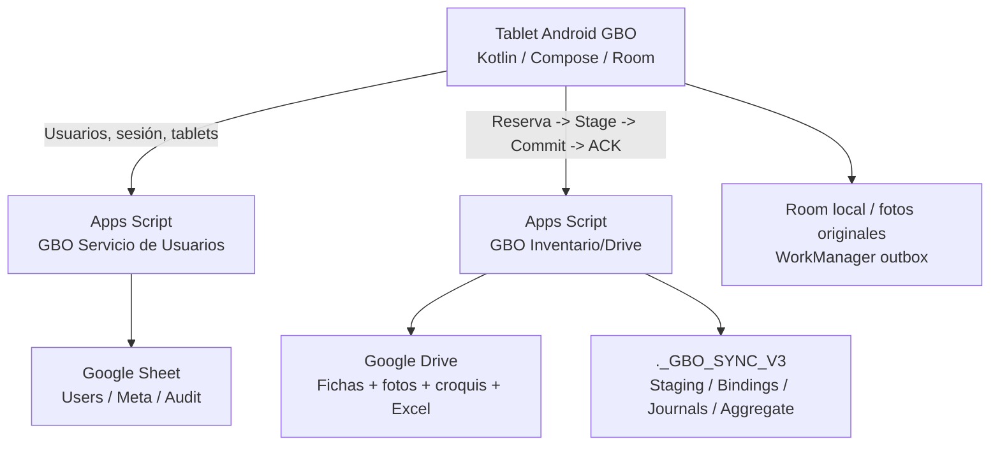

# GBO Inventario Vial — Manual maestro de continuidad, transferencia y cierre de observaciones

**Edición:** 30 de octubre de 2026 · **Audiencia:** desarrollador que se incorpora al proyecto sin conocer su historia · **Estado:** guía de transferencia, NO autorización de producción · **Prompts P00–P99 incluidos al final (Anexo A)**

> **LEER ANTES DE EMPEZAR.** Este manual incorpora el estado de `ESTADO_PARA_CONTINUAR.md`, los informes P0–P0.3 y de entrega urgente, las cinco observaciones formales del PDF `OBSERVACIONES APLICATIVO`, las fotografías y comentarios de los ingenieros, y antecedentes técnicos de «GBO servidor». **No sustituye la inspección del repositorio ni demuestra por sí solo que el último código funcione.** Lo indicado como **WIP** no está aprobado para distribución. No contiene contraseñas, tokens o IDs de despliegue privados.

---

## 0. LEER EN 5 MINUTOS — RESUMEN OPERATIVO

### 0.1. Qué es GBO

GBO Inventario Vial es una aplicación **Android/Kotlin**, con formularios **SIC** (inventario vial), **SCAP** (puentes/obras de arte), **Pavimentos**, fotografías, croquis, progresivas, apoyo de GPS/mapas offline, almacenamiento local **Room** y sincronización offline-first por **WorkManager**. La app envía entregas a un **Google Apps Script de Inventario/Drive**, que crea y organiza archivos en Google Drive, y usa **otro Apps Script distinto** para usuarios, tablets, PIN/roles y autorizaciones. Hay hojas de cálculo y generación de documentos/Excel, así como evidencias fotográficas. **Nunca intercambiar las URL de estos dos servicios.**

### 0.2. Situación real al entregar este manual

| Tema | Estado verificable a 30/10/2026 |
|---|---|
| Código principal | Preservado localmente en `C:\GBO`, rama `codex/observaciones-campo-asus-20261030`, último HEAD **`658e4abb8ee07c700dd865c1179b542d9cccb28b`**, según el cierre comunicado. Confirmar con `git rev-parse HEAD`. |
| GitHub | `https://github.com/a20231408-gif/GBOfinal`; repositorio **público** al último control; **la rama de estos cambios NO fue publicada**. No clonar desde GitHub asumiendo que tiene el trabajo reciente. |
| Respaldo | `C:\Users\ASUS\GBO_RESPALDO_PRIVADO_20261030_1300`; contiene Git bundle, manifiestos, evidencias y material privado separado. |
| Android antes de WIP | Release **1.4.19 (versionCode 33)**, firmada con certificado histórico, preparada para backend anterior, **no distribuir**. |
| Android WIP posterior | Limpieza de registros entregados, Pavimentos, nomenclatura. **Todavía no está compilado como Release final validada**. Para un nuevo candidato usar versionCode **superior a 33** (confirmar códigos posteriores antes de elegir). |
| Pruebas Android | 198/198 en selección anterior al WIP; 35/35 de continuación; 12/12 focalizadas después del WIP; **NO** equivalen a suite completa ni a prueba en tablets. |
| Backend nuevo | Código reanudable y journal probados en entorno **aislado**: primer escenario 59 archivos + 3 aportes SIC, 67/67 operaciones, 62/62 hashes/propietarios/rutas, ACK HTTP, idempotencia y BUSY. |
| Segunda raíz de prueba | 59/59 archivos **solo en staging**. **No se ejecutó commit ni hay ACK** allí. |
| Backend anterior | Producción sin cambios durante estas fases; capacidades consultadas, pero **sin validación autorizada de entrega grande con ACK en campo**. |
| Usuarios | Servicio aparte, historial de `users-v2.4-tablet-admin`; no modificar ni confundir con Drive. Su despliegue efectivo debe verificarse independientemente. |
| Campo | Flavio reportó problemas de subida SCAP, Julián pudo subir. **No hay diagnóstico físico autorizado y concluido de ambas tablets**. |
| Decisión | **NO-GO para distribución general y corte al nuevo Google Drive** hasta completar pilotos y protección de pendientes. |

### 0.3. Tres reglas para no destruir datos

1. **Una ficha no está entregada por haber llegado a staging o por mostrar 100 %.** Solo un ACK íntegro correspondiente a la **revisión actual**, UUID, archivos, hashes, SIC y raíz correctos acredita entrega. Videos requieren tratamiento de confirmación propio.
2. **Nunca cambiar la URL o raíz de Drive de una tablet con revisiones pendientes o preparadas sin conciliación.** Reservas, paths y bindings son durables; no trasladar paquetes congelados al servidor nuevo como si nada.
3. **No desinstalar, borrar datos, limpiar caché, reinicializar Room, reemplazar firma o bajar versionCode para solucionar problemas de campo.** Esas acciones pueden impedir recuperación o destruir fichas.

### 0.4. Objetivo de la transferencia

Que otra persona pueda instalar el entorno, abrir el repositorio correcto, ejecutar pruebas, terminar las observaciones y entregar una **APK Release firmada y probada**. Se priorizan correcciones locales sin acceso productivo; la migración de Google requiere un corte controlado y autorizaciones diferenciadas.

---

## 1. GLOSARIO QUE DEBE CONOCER EL NUEVO DESARROLLADOR

| Término | Significado práctico |
|---|---|
| **SIC** | Inventario vial; incluye formularios y aportes que pueden consolidarse en `EXCEL_SIC`. No todos los aportes son archivos separados dentro de la carpeta SCAP. |
| **SCAP** | Captura de puentes y anexos. Tiene entidad de inspección, nombre real del puente y fotografías por categorías; no asumir que `PUENTE 1` equivale al nombre real. |
| **Pavimentos** | Evaluación por unidades de muestra y fallas/daños, incluida severidad del sello de junta (daño 26). Autoguardado en Room debe separarse de publicación visible en Drive. |
| **PR / progresiva** | Ubicación kilométrica, por ejemplo `PE-28H - PR 40+200`. La distancia entre `42+995` y `43+005` es 10 m. |
| **Room** | Base de datos de Android; en el cierre era esquema 21. No borrar sus archivos para arreglar un bug. |
| **WorkManager** | Cola programada de entregas, backoff, recuperación offline. Puede reintentar, pero no debe inventar confirmaciones. |
| **V2 de fotos** | Contrato de nombres/categorías de foto reservados por servidor. El flag `GBO_PHOTO_NAMES_V2_ENABLED` era `true` en la configuración legítima restaurada. |
| **Sync V3 / protocolo 3** | Protocolo de publicación con reservas, staging, commit y ACK; pathVersion 4 y convenciones SCAP V2. |
| **Binding** | Asociación durable entre UUID/elemento, folderId/número/ruta. No renombrar carpetas históricas a ciegas. |
| **Staging** | Carga previa de archivos aún no entregados contractual y definitivamente. |
| **Journal** | Registro durable de operaciones de commit y reanudación; un `PENDING` es trabajo pendiente, no éxito. |
| **ACK** | Recibo final validado. Debe corresponder a identidad, revisión y todos los archivos esperados. |
| **BUSY** | Servidor ocupado; conservar estado y reintentar prudentemente, sin crear una entrega competidora. |
| **WIP** | Trabajo preservado en commits, pero no integralmente terminado ni probado. |
| **Release** | APK oficial con mismo applicationId y certificado histórico; distinto de debug o APK de ensayo. |
| **`/exec`** | URL de una implementación versionada de Apps Script. Guardar código no actualiza automáticamente el despliegue. |

---

## 2. MAPA DE ARQUITECTURA Y LÍMITES



### 2.1. Android

Tecnologías/familias acreditadas: Kotlin y Compose; Room (históricamente versión de esquema 21); WorkManager, cámara/FIleProvider/fotos, GPS, mapas offline, formularios SIC/SCAP/Pavimentos y exportaciones. Los nombres exactos y paquetes deben inspeccionarse desde el clone actual. El `applicationId` de la app oficial es `com.tuempresa.inventariovial`. Existe un build de ensayo con `com.tuempresa.inventariovial.ensayo`: **NO actualiza** la app oficial.

Puntos de entrada/conceptos conocidos por informes:

- `app/src/main/java/com/tuempresa/inventariovial/core/AutomaticDelivery.kt`: preparación, reserva y paquete.
- `AutomaticSync`, `AutomaticSyncDrain`: cola, WorkManager y recuperación.
- `DriveDeliveryPresentation.kt`, `DriveDeliveryCard.kt`, `DriveSyncCenter.kt`, `UnifiedRecordsScreen.kt`: estados/UI.
- `AutomaticLocalDocuments.kt`, `LocalCopies.kt`, `SharedDocumentStore.kt`, `ConfirmedLocalCleanup.kt`: publicaciones/copias/limpieza local; **algunos son WIP**.
- `PublicLocalFolderNames`, `core/PublicDeliveryNames.kt`: nombres de carpetas. `PublicDeliveryNames.kt` es **provisional y no integrado**.
- `ScapInspectionEntity.bridgeName` y `singularityName`: fuentes del nombre real del puente.
- `TechnicalLengthExport` y componentes de progresiva/edición: persistencia de longitudes.
- `PhotoTransport10Test`, `ScapUrgentIntegrityTest`, `FieldCleanupAndConsolidationTest` y clases de regresión: no cambiar expectativas sin justificar contrato.

Los nombres son referencias de informes, no un inventario generado del árbol Git real. Usar `rg`/búsqueda de Android Studio para confirmar rutas y llamadas.

### 2.2. Apps Script de Usuarios — NO TOCAR EN EL CIERRE DE DRIVE

Servicio distinto, históricamente identificado como `GBO - Servicio de Usuarios`; utiliza la hoja `GBO - Usuarios Inventario Vial` con pestañas `Users`, `Meta`, `Audit`. El servicio gestiona autenticación, PIN/roles, autorización y revocación de tablets; `ADMIN` no implica automáticamente `TABLET_ADMIN`.

Piezas históricas: `Code.gs`, `Users.gs`, `Security.gs`, `Auth.gs`, `Audit.gs`, `Crypto.gs`, `TabletAdmin.gs`. Acciones históricas documentadas: `syncUsers`, `provisionTablet()`, `revokeTablet()`, `applyTabletAdminPermission`, además de funciones administrativas posteriores. Los registros `TABLET_<deviceId>` mantienen token hash/activación. La implementación registrada en octubre respondía `users-v2.4-tablet-admin`; **reconfirmar versión activa y endpoint**, no deducir que un archivo de referencia esté publicado.

La URL de este servicio corresponde a `SERVER_BASE_URL` en Android (`server.local.properties`). La URL de Drive **nunca** va en este campo. En una incidencia previa se introdujo la URL de Drive en inicio de sesión y generó un error; se solucionó usando Usuarios. Una APK puede persistir URL/token en preferencias y no sustituirlos al actualizar: revisar esto en un piloto sin borrar la configuración existente.

**No** copiar usuarios, PIN, hashes, `SERVER_RANDOM_KEY`, propiedades o información de la hoja para desarrollar la UI. Si se requiere administración de tablets, gestionar permiso `TABLET_ADMIN` por procedimiento oficial, nunca recrear la hoja o reiniciar el servicio.

### 2.3. Apps Script de Inventario/Drive

Proyecto original de referencia: **GBO_Inventario**

- Editor: `https://script.google.com/d/<ID_PRIVADO_EN_RESPALDO>/edit`
- Propietario constatado en la verificación anterior: otra cuenta (`rcercadole@gmail.com`), **no** la cuenta destino GBO.
- Versión **21** observada en el entorno original; confirmar despliegue real antes de modificar.
- Fuente de referencia local: `backend/referencia-v21/`; no asumir identidad byte a byte de todos los módulos sin comparar.
- Funciones/archivos históricos: `Code.gs`, `SyncV3.gs`, `SyncV3Core.gs`, `SicObservationsV1Core.gs` y otros módulos del repo.
- Protocolo esperado: `syncProtocol=3`, `pathVersion=4`, numeración estable, `readablePhotoNamingVersion=2`, panel SCAP V2, categorías y reservas de nombres.
- Límites anotados en diagnóstico de referencia: hasta **80 archivos por entrega**, hasta **24 MiB por staging** y **160 MiB por revisión**. Verificar límite efectivo en el despliegue que se use.

El backend organiza Drive, prepara documentos, fotos y croquis, consolida aportes SIC; confirma mediante ACK. Hay carpeta técnica `._GBO_SYNC_V3` (STAGING, Bindings, Journals, Aggregate). **No borrar ni mover dicha carpeta ni exponerla como navegación normal para ingenieros.**

### 2.4. Cuenta y Drive destino

- Cuenta administradora/ejecutora requerida: `reconocimientoinventariovial@gmail.com`.
- Carpeta destino: **1.- ARCHIVOS CAMPO**.
- Enlace: `https://drive.google.com/drive/folders/<ID_PRIVADO_EN_RESPALDO>`.
- Identificador carpeta: `<ID_PRIVADO_EN_RESPALDO>`.
- Al cierre: **no** es aún la raíz productiva de nuevas tablets, la migración no se hizo. La última verificación de metadatos indicó que esta carpeta pertenece a la cuenta GBO.
- Se detectó históricamente `anyone/writer` en el recurso original y la carpeta destino: **riesgo de permisos abiertos**, verificar estado actual y restringir solo tras inventariar accesos legítimos; no hacerlo a ciegas.

### 2.5. Backend reanudable aislado

- Fuentes versionables: `backend/aislado-commit-resumible/`.
- Copia Google creada bajo cuenta GBO: `GBO_Inventario_PRUEBAS_GBO_20261030_NO_CORTE`.
- Despliegue HTTP de **pruebas** autorizado con token de aplicación y guardas de raíz ficticia; no es backend final.
- Propiedad de aislamiento privada: `GBO_ISOLATED_ROOT_ID` (el valor real no entra en Git).
- En la **primera raíz**, se recuperó el commit de 59 archivos y 3 SIC: `COMPLETE`, 67/67 operaciones y 62/62 objetos verificables; ACK y reintento idempotente sin duplicados.
- En la **segunda raíz**, 59/59 archivos quedaron en staging; **sin commit ni ACK**. No confundir ambos escenarios.
- Las métricas indicaron coste relevante por escrituras de journal; código corrigió reanudación con conciliación de IDs e intenciones durables. Esto **no prueba** que el backend pueda ponerse directamente en producción sin adaptar guardas y validar ruta final.

### 2.6. Un servicio responde `success`; el otro responde `ok`

El servicio Usuarios ha usado en sus contratos `success`, `syncUsers`, `deviceId`, `tabletToken`, `clientVersion`. Inventario/Drive usa respuestas del protocolo de entrega y `ok`. No hacer un cliente genérico que trate ambas respuestas como equivalentes sin contrato. HTTP 401/403 en Drive son bloqueo/autorización, no errores transitorios de red; BUSY puede ser recuperable. El cliente debe negociar capacidades y clasificar estados sin falsos positivos.

---

## 3. FUENTES DE VERDAD, ESTADO GIT Y RESPALDOS

### 3.1. Orden de autoridad

1. **Código real de la rama y los cambios Git**: confirma lo implementado, no necesariamente lo desplegado.
2. **`docs/ESTADO_PARA_CONTINUAR.md`** y **`CIERRE_VERIFICADO.json`** privado: confirman el cierre de 30/10/2026.
3. **Logs/XML/journals guardados**: confirman pruebas concretas, no todo el sistema.
4. **Versiones/despliegues actuales observados en Google**: confirman qué código atiende peticiones.
5. **Diagnóstico físico de la tablet y recibos en Drive**: confirman la realidad en campo.
6. **Informes históricos P0 y anteriores**: contexto, no reemplazo de evidencia posterior.

### 3.2. Referencias Git que no se deben mezclar

- Base ASUS histórica: `dbe7247`, rama `codex/migracion-asus-20261029`.
- Rama activa para traspaso: `codex/observaciones-campo-asus-20261030`.
- HEAD final comunicado: `658e4abb8ee07c700dd865c1179b542d9cccb28b`.
- Backend reanudable: `a9e1393`.
- Pruebas Android de continuación: `7e9739e`.
- WIP limpieza + Pavimentos: `ce4b727`.
- WIP nombres: `243ea4c`.
- Pruebas focalizadas WIP: `e441881`.
- Antes de WIP, Release 1.4.19 (33) preparada alrededor de `05a0ead`.
- No modificar `main` directamente; el remoto no recibió la rama a la fecha del informe.

### 3.3. Respaldo independiente y por qué existe

`C:\Users\ASUS\GBO_RESPALDO_PRIVADO_20261030_1300` contiene:

```text
GBO_RESPALDO_PRIVADO_20261030_1300/
  repositorio/
    GBO_CIERRE_20261030.bundle
  evidencias/
    ... XML, logs, resultados y soportes de pruebas ...
  privado/
    ... properties, keystore, APK, propiedades/IDs/journal Google ...
  CIERRE_VERIFICADO.json
  MANIFIESTO_SHA256.json
```

**Atención:** el respaldo también contiene fuentes exactas del editor de prueba, alternativas propuestas pero **no ejecutadas**, capturas PNG y material confidencial. No copiar `privado/` completo a una laptop de terceros si solo va a desarrollar UI. El propietario debe preparar un subconjunto cifrado según función.

### 3.4. APK conservadas — NO CONFUNDIR

| APK | Uso | Identificador |
|---|---|---|
| `C:\GBO\tmp\entrega-20261030\release-online\GBO_1.4.19_33_CANDIDATA_NO_DISTRIBUIR.apk` | Candidate 1.4.19/33 **anterior a WIP**, backend anterior; **no distribuir** por el cierre | `com.tuempresa.inventariovial` |
| `C:\GBO\tmp\entrega-20261030\backend-privado\desbloqueo\GBO_1.4.19_33_ENSAYO_SCAP_NO_DISTRIBUIR.apk` | Ensayo aislado, token/endpoint ficticio; **no campo** | `com.tuempresa.inventariovial.ensayo` |

Certificado histórico SHA-256: `0da8a2cbcf6bce5554526c80de08878d077af1542e488292b3869cdd8ee17315`.

SHA-256 APK previa: `0aa733c794f097eefce06be3a2c1fb0ba555d45cd53702ade51b552165dc4254`.

SHA-256 APK ensayo: `073f005a8475a5342a0e667cc2174b8cd3a31c976fa3cc4b3f8b01e69108b2b8`.

Los hashes son para **verificar esos archivos concretos**, no para validar una APK reconstruida después. Una APK con WIP corregido requiere nuevo build, revisión, pruebas y versionCode mayor que el distribuido/conocido (en esta línea al menos 34 si no existe otro superior).

---

## 4. INSTALACIÓN COMPLETA EN WINDOWS (NUEVA LAPTOP)

### 4.1. Antes de descargar nada

Responsables:

- **Propietario del proyecto:** hace privado GitHub, invita a colaborador, mantiene credenciales/keystore, autoriza despliegues y acceso a tablets.
- **Compañero:** clona, instala herramientas, ejecuta pruebas, trabaja en rama propia y entrega cambios revisables.

El compañero necesitará un equipo Windows con suficiente espacio en SSD (Android SDK/Gradle pueden consumir decenas de GB). No necesita emulador si dispone de un dispositivo de pruebas autorizado; no usar tablets con datos reales como entorno de desarrollo inicial.

Instalar desde sitios oficiales: Git para Windows, Android Studio, control de versiones en su cuenta GitHub, opcional Node.js LTS si ejecutará tests `.js`/`.cjs` del backend; si usará `clasp` requerirá Node y autenticación Google oficial. No actualizar bibliotecas/proyecto solo porque Android Studio sugiera una versión nueva.

### 4.2. Git en Windows

1. Instalar Git for Windows desde `https://git-scm.com/download/win`.
2. Abrir **PowerShell** (terminal de Windows) y comprobar:

```powershell
git --version
git config --global user.name "NOMBRE_DE_TU_COMPAÑERO"
git config --global user.email "CORREO_DE_GITHUB_DEL_COMPAÑERO"
git config --global --get user.name
git config --global --get user.email
```

Usar la identidad propia del compañero, **no** usar el correo/cuenta del propietario del proyecto. Activar doble factor en GitHub. Para repositorios privados, Git for Windows/Git Credential Manager puede abrir un inicio de sesión; no pedir ni pegar contraseñas, cookies o tokens en un chat.

### 4.3. Primero: hacer privado el repositorio (propietario)

**Obligatorio ANTES de publicar la rama.** En GitHub:

1. Ir a `https://github.com/a20231408-gif/GBOfinal` con la cuenta propietaria.
2. Abrir **Settings**.
3. Buscar **Danger Zone → Change repository visibility → Change visibility**.
4. Elegir **Private** y seguir las confirmaciones de GitHub.
5. Volver a la página del repositorio y confirmar la insignia **Private**; usar API/CLI autenticada si se desea doble verificación.
6. Invitar al compañero: **Settings → Collaborators → Add people**; enviar invitación a **su propia cuenta** y esperar aceptación.

**Importante:** convertir a privado no revoca secretos históricamente expuestos, no convierte forks públicos en privados ni elimina copias existentes. Si hay sospecha de credenciales expuestas, rotarlas y revisar la historia con criterio profesional, no hacer un force-push improvisado.

### 4.4. Publicar la rama consolidada desde ASUS (propietario)

En **ASUS**, no en la laptop nueva:

```powershell
Set-Location C:\GBO
git status --short
git branch --show-current
git rev-parse HEAD
git remote -v
git fetch origin
git log --oneline -10
git log --oneline origin/main..HEAD
```

Comprobar rama `codex/observaciones-campo-asus-20261030`, HEAD esperado `658e4abb...` y árbol limpio. Si hay diferencias, entenderlas antes de actuar. Revisar específicamente archivos rastreados y los que saldrían en el push. **La privacidad de GitHub y el escaneo local deben aprobarse ambos; lo uno no sustituye lo otro.**

```powershell
# Lista SOLO de los archivos en los commits que aún no están en main:
git diff --name-only origin/main...HEAD
# Archivos del commit más reciente:
git show --stat --oneline HEAD
# Revisar ignorados y keystore sin extensión:
git check-ignore -v gbo-inventario-vial-release
# No mostrará el contenido; buscar accidentalmente rastreados:
git ls-files | Select-String -Pattern 'properties|keystore|\.jks$|\.apk$|backend-privado|\.db$'
```

`git ls-files` puede incluir `gradle.properties` legítimo y archivos de ejemplo: revisar **contenido real** con seguridad antes del push. Si hay archivo secreto rastreado, **no publicar**. No imprimir tokens en consola ni en capturas del informe.

Luego de confirmar privacidad y revisión del historial, y con autorización del propietario:

```powershell
git push -u origin codex/observaciones-campo-asus-20261030
# Verificar que remoto apunta al mismo commit:
git ls-remote --heads origin codex/observaciones-campo-asus-20261030
# Comparar SHA obtenido con git rev-parse HEAD
```

No hacer `push --force`, `push --all`, merge a `main`, ni publicar backups/archivos WIP privados sin revisar. Registrar la URL de la rama y SHA remoto en el documento de continuidad.

### 4.5. Clonar en la laptop del compañero (si push verificado)

Desde PowerShell, ya con invitación aceptada:

```powershell
New-Item -ItemType Directory -Path C:\Desarrollo -Force | Out-Null
Set-Location C:\Desarrollo
git clone --branch codex/observaciones-campo-asus-20261030 --single-branch https://github.com/a20231408-gif/GBOfinal.git GBO
git -C C:\Desarrollo\GBO status --short
git -C C:\Desarrollo\GBO rev-parse HEAD
```

El SHA debería coincidir con el HEAD publicado. Si Git indica `repository not found`, comprobar invitación, sesión GitHub y acceso privado; **no** cambiar el enlace por un fork o ZIP antiguo sin revisar el commit.

Si la rama no aparece, detenerse; no usar `main` suponiendo que contiene el WIP.

### 4.6. Recuperación alternativa si GitHub continúa bloqueado: Git bundle

Este método entrega el código y la historia **sin GitHub**, desde un medio privado cifrado, y está documentado en el cierre:

```powershell
git bundle verify 'X:\respaldo\repositorio\GBO_CIERRE_20261030.bundle'
git clone -b codex/observaciones-campo-asus-20261030 'X:\respaldo\repositorio\GBO_CIERRE_20261030.bundle' C:\GBO_RECUPERADO
git -C C:\GBO_RECUPERADO rev-parse HEAD
git -C C:\GBO_RECUPERADO remote set-url origin https://github.com/a20231408-gif/GBOfinal.git
```

`X:` es la unidad **de ejemplo** donde el compañero haya montado el respaldo; cambiarla. No enviar el bundle a un repositorio público ni a un chat. Al clonar desde el bundle, el `origin` vuelve a GitHub por el comando mostrado, pero **eso no sube nada**. Verificar rama y SHA antes de trabajar.

### 4.7. Instalar Android Studio y abrir el proyecto

1. Descargar Android Studio desde `https://developer.android.com/studio/install` e instalar usando su asistente oficial.
2. En **SDK Manager**, comprobar que están disponibles las plataformas y Build Tools exigidas por el repositorio. En la ASUS del cierre se usó Android Platform **android-37** y Build Tools **36.0.0**. No cambiar gradle/build scripts para adaptar la app a un SDK distinto sin necesidad.
3. Abrir Android Studio → **Open** → carpeta raíz `C:\Desarrollo\GBO` (o `C:\GBO_RECUPERADO`), donde estén `gradlew.bat` y `settings.gradle`/`settings.gradle.kts`.
4. Esperar sincronización Gradle. Usar el JDK/JBR compatible con el wrapper y AGP del proyecto; en ASUS se usó `C:\Program Files\Android\Android Studio\jbr`. La documentación de migración registró Gradle 9.6 / Java 25; **verificar contra el wrapper real y `java -version` en el equipo**, no forzar actualización.
5. Si aparece "SDK location not found", crear/editar **solo** `local.properties` con el SDK de esa laptop; no copiar la ruta de ASUS/Huawei.

Ejemplo PowerShell para recuperar la ruta SDK:

```powershell
$Sdk = Join-Path $env:LOCALAPPDATA 'Android\Sdk'
Test-Path $Sdk
# Crear local.properties solo si no existe y se confirmó la ruta:
"sdk.dir=$($Sdk -replace '\\','/')" | Set-Content -Path 'C:\Desarrollo\GBO\local.properties' -Encoding ASCII
```

**Antes de sobrescribir `local.properties`, inspeccionarlo;** si contiene otras propiedades locales, modificar únicamente `sdk.dir` y preservar las demás. En el cierre de ASUS `sdk.dir=C:/Users/ASUS/AppData/Local/Android/Sdk` — esa ruta NO sirve en otra cuenta Windows.

### 4.8. Primera comprobación del proyecto

```powershell
Set-Location C:\Desarrollo\GBO
$env:JAVA_HOME = 'C:\Program Files\Android\Android Studio\jbr'
.\gradlew.bat --version
.\gradlew.bat :app:tasks --all
```

Si falla por JDK, SDK, archivos `.properties`, internet/Gradle o plugin inexistente, **identificar la causa exacta** y no modificar versiones a ciegas. Tras instalar paquetes oficiales, las dependencias pueden descargarse; la primera compilación no necesariamente funciona offline.

---

## 5. CONFIGURACIÓN PRIVADA: QUÉ PASAR Y QUÉ NO PASAR

**Punto crítico:** GitHub preserva el código versionado, pero **no** las propiedades, keystore, evidencia de Drive, APK ni datos locales ignorados. El responsable debe transferir lo mínimo necesario por **un medio cifrado privado**, o configurar los valores directamente en el equipo autorizado.

### 5.1. Matriz de archivos para el compañero

| Archivo/artefacto | ¿En GitHub? | ¿Pasarlo? | Condición |
|---|---|---|---|
| Código Android/Kotlin, tests, Gradle wrapper, fuentes `.gs` sin secretos | Sí, tras push a repo privado | Sí, por clone | No enviar ZIP mezclado con privados. |
| `docs/ESTADO_PARA_CONTINUAR.md` y este manual | Puede estar en repo privado tras revisión | Sí | El manual también se puede entregar como archivo privado. |
| `local.properties` | No | **Recrear**, no copiar desde ASUS | Debe apuntar al SDK de su Windows. |
| `server.local.properties` | No | Solo si debe probar autenticación real | Preferir configuración aislada autorizada; nunca compartir la productiva por chat. |
| `drive.local.properties` | No | Solo para integración real autorizada | Separar token/endpoint de pruebas de los productivos; nunca sustituir URL de Usuarios. |
| `keystore.properties` | No | Solo si compilará Release oficial | Contiene referencias y normalmente contraseñas; mínimo privilegio. |
| `gbo-inventario-vial-release` sin extensión | No | Solo a firmante autorizado | Es **clave privada histórica**. Preferible que la Release final la firme el propietario en ASUS. |
| `backend-privado/` y backup `privado/` | No | **No completo por defecto** | Seleccionar solo fuentes/configuración imprescindible; contiene secretos, IDs y ensayos. |
| `GBO_CIERRE_20261030.bundle` | No | Sí si no hay push | Por medio cifrado, comparar `MANIFIESTO_SHA256.json`. |
| `evidencias/`, XML, logs, capturas | No | Solo recorte pertinente | Pueden contener rutas/identificadores y datos de campo. |
| APK 1.4.19/33 anterior | No | Opcional como referencia, **no instalar** | Hash documentado. No refleja WIP. |
| APK de ensayo `.ensayo` | No | Solo para desarrollo controlado | Nunca entregar a ingenieros. |
| Propiedades `GBO_ISOLATED_ROOT_ID`, token HTTP de prueba | No | Solo al integrador de Apps Script autorizado | No poner en app de campo ni en Git. |
| Capturas originales de ingenieros, PDF de observaciones | No necesariamente | Sí, versiones saneadas para QA | Si incluyen nombres/datos reales, compartir bajo acceso restringido. |
| Datos reales Room, fotografías, tabletTokens, hojas de Usuarios | No | **No** para desarrollar | Acceso de lectura solo con autorización y necesidad. |

### 5.2. Cómo copiar archivos privados en Windows sin publicarlos

1. Propietario crea una carpeta temporal cifrada (por ejemplo, contenedor cifrado con herramienta aprobada o medio corporativo cifrado). No basta con un ZIP normal ni con ACL de Windows.
2. Selecciona los archivos mínimos para el rol. Para trabajo UI, puede bastar código + datos de prueba sintéticos.
3. Compara SHA-256 del paquete enviado y recibido:

```powershell
Get-FileHash 'X:\transferencia\GBO_PRIVADO_AUTORIZADO.7z' -Algorithm SHA256
```

4. Entrega la clave de cifrado **por un canal distinto** del archivo y solo a la persona autorizada.
5. El compañero extrae en ruta protegida **fuera del repositorio**; copia los `.properties` al directorio raíz solo si necesita esos servicios. Configura keystore con ruta local únicamente si va a firmar.
6. Verifica que `git status --short` no muestre archivos privados y que `git check-ignore -v` los ignore. No hacer `git add -f` con privados.
7. No incluir secretos en prompts, capturas, logs, issues o PR.

Si el equipo es ajeno o de uso compartido, **no** entregar la firma histórica ni acceso productivo. Permitirle entregar código y tests; el propietario realizará compilación oficial y despliegue.

### 5.3. Qué variables deben comprobarse sin imprimir sus valores

- `SERVER_BASE_URL` del servicio Usuarios, en `server.local.properties`.
- `DRIVE_WEB_APP_URL` y `DRIVE_API_TOKEN`, relacionados con Inventario/Drive, en `drive.local.properties`.
- Flags: `GBO_PHOTO_NAMES_V2_ENABLED=true`; `SIC17A_ENABLED=false`; `SIC17B_ENABLED=false`, salvo nueva decisión técnica debidamente probada.
- Firma: `GBO_RELEASE_STORE_FILE` y demás propiedades `GBO_RELEASE_*` en `keystore.properties`.
- Scripts de Google: root ID de pruebas, tokens y propiedades sensibles solo en configuración privada de Apps Script.
- URL persistida en tablet/Preferencias: podría diferir de la compilada; no asumir migración automática.

### 5.4. Ejecutar la guarda Release (solo en equipo firmante)

```powershell
Set-Location C:\Desarrollo\GBO
$env:JAVA_HOME = 'C:\Program Files\Android\Android Studio\jbr'
.\gradlew.bat --no-configuration-cache :app:validateReleaseConfiguration
```

No sustituir keystore ni crear clave nueva si falla. Comparar el certificado público esperado (ver §3.4). Ejecutar la tarea solamente donde están los archivos privados legítimos. Si no los tiene el compañero, **que compile Debug y trabaje con tests, no que simule Release**.

---

## 6. GIT EN EQUIPO: CÓMO COLABORAR SIN PISARSE

### 6.1. Rama propia del compañero

Después de clonar la rama de transferencia:

```powershell
Set-Location C:\Desarrollo\GBO
git status --short
git switch codex/observaciones-campo-asus-20261030
git switch -c feat/cierre-observaciones-campo
git branch --show-current
```

No crear una rama desde `main` porque puede carecer de Work, backend reanudable y WIP reciente.

### 6.2. Flujo por cambio

1. Registrar objetivo y archivos afectados.
2. Confirmar `git status --short` limpio antes de comenzar.
3. Editar solo el módulo responsable y tests próximos.
4. Ejecutar la prueba mínima y la regresión relevante.
5. Revisar `git diff`, capturar resultados y confirmar secretos excluidos.
6. Crear commit enfocado, p.ej. `fix(pavement): publish only on unit completion`.
7. Hacer push a rama propia en repo **privado** y abrir PR hacia `codex/observaciones-campo-asus-20261030` o rama de integración acordada.
8. Propietario revisa código + contratos + prueba, luego decide merge. **No** push a `main` ni rebase sobre una rama que recibió cambios simultáneos sin coordinación.

### 6.3. División sugerida para acelerar

- **Compañero:** WIP Android (limpieza segura, Pavimentos, nombres/UI) y tests sintéticos.
- **Propietario ASUS:** firma histórica, integración final, respaldo; manejo de pendientes de campo y autorización de piloto.
- **Un solo responsable designado para Apps Script de Drive:** adapta el backend reanudable, revisa permisos, integra con nombres y prepara corte. Evitar que dos Codex distintos modifiquen el mismo deployment en paralelo.

Con trabajo paralelo, definir de antemano contrato de nombres JSON/reservas y de confirmación ACK antes de tocar Android y `.gs` simultáneamente.

---

## 7. MATRIZ MAESTRA DE OBSERVACIONES DE CAMPO

**Significado de estado:** `LOCAL OK` = implementado/probado en selección local; `WIP` = preservado pero sin pruebas integrales; `PARCIAL` = funciona una parte; `PENDIENTE` = falta implementación o evidencia; `CAMPO NO VERIFICADO` = no hay validación física, aunque código local parezca correcto. **Ningún ítem está «cerrado por ingeniería de campo» hasta la aceptación en tablet.**

| ID | Prioridad | Requisito del ingeniero | Estado de código al cierre | Criterio concreto de aceptación |
|---|---|---|---|---|
| **OBS-01** | Alta | Filtrar por día/mes/año, sin lista desordenada | **LOCAL OK**: `RecordDateFilterTest`, UI de Work | Elegir día/mes/año, reiniciar app, comprobar filtro y orden cronológico. |
| **OBS-02** | Alta | Filtrar borrador, pendiente y enviado | **LOCAL OK** | Comprobar que Enviado = ACK de revisión actual, no staging; totales explicados. |
| **OBS-03** | Alta | Orden cronológico y búsqueda rápida de registros | **LOCAL OK/PARCIAL UX** | Orden consistente y acceso a una ficha sin abrir listas técnicas. |
| **OBS-04** | Alta | Descartar individualmente o varios borradores | **LOCAL OK**: `42e8a04` y LocalDraftDiscard | Selección y restauración sin perder originales ni referencias. |
| **OBS-05** | **Crítica** | Limpiar registros de prueba y empezar nuevo tramo | **WIP** (`ce4b727`) | Borradores elegibles descartables; entregados con ZIP íntegro y restauración; pendiente no se toca. |
| **OBS-06** | Crítica | Liberar espacio tras archivos ya entregados | **WIP** | Comprobar ACK corriente y respaldo ZIP leído/verificado; eliminación solo de copias públicas autorizadas; conservar originales/Room según política. |
| **OBS-07** | Alta | Carpetas con nombre de elemento, ruta y progresiva, ruta corta | **PARCIAL**: local mejorado; remoto falta | Vista pública local y remota razonablemente equivalente y nombres estables, sin UUID/paths largos al usuario. |
| **OBS-08** | Alta | Fotos con nombres element–PR–categoría–número | **PENDIENTE** (`PublicDeliveryNames.kt` sin integrar) | Nombres correctos sin colisiones, Unicode seguro, V2 reservas y ACK; no renombrar históricos. |
| **OBS-09** | Alta | Carpeta real puente en vez de `PUENTE 1/2/3` | **PENDIENTE en Drive** | `bridgeName` visible, binding estable y compatibility para históricos; esquema versionado probado. |
| **OBS-10** | Alta | Distancia entre progresivas en distinto kilómetro | **LOCAL OK** (`4c44a9f`) | `42+995`→`43+005` = 10 m, guardado/reapertura/JSON/Excel coherentes. |
| **OBS-11** | Alta | Daño 26: severidad independiente por losa/junta | **LOCAL OK según regresiones** | L/M/H distintas en losas diferentes, sin sobrescritura; correcta reapertura, exportación y PCI contractual. |
| **OBS-12** | Alta | Autoguardado Pavimentos sin decenas de carpetas `REVISIONES/R_<timestamp>` | **WIP** (`ce4b727`) | Guardar cada daño en Room sin publicar múltiples entregas públicas; consolidar al finalizar unidad. |
| **OBS-13** | Media | Reconciliar con Drive no debe ocupar pantalla | **LOCAL OK/PARCIAL UX** | Detalle técnico desplegable, acción principal clara. |
| **OBS-14** | Crítica | Flavio no consigue subir SCAP, Julián sí | **CAMPO NO VERIFICADO** | Comparar versiones/config, sesión, red, código error, revisiones, ACK y contenido remoto, sin borrar datos. |
| **OBS-15** | Crítica | Mostrar preparación, subida, verificación y errores | **LOCAL OK** (P0) | Mensajes claros en tablets; HTTP 401/403 BLOCKED, 503 recuperable; staging ≠ ACK. |
| **OBS-16** | Crítica | Subida lenta de SCAP de muchas fotos | **PARCIAL** backend aislado completo; campo no | Commit grande (59 archivos) con ACK y reintentos seguros en entorno destinado; pruebas de piloto final. |
| **OBS-17** | Crítica | SIC aparentemente faltantes junto a puentes | **SIN CONCILIAR** | Revisar `sicRows`, `pendingSic`, `sicFiles`, `retainedSicFormats` y `<RUTA>/EXCEL_SIC`; no asumir pérdida. |
| **OBS-18** | Alta | Abrir fotos/Excel/PDF/local de forma fácil | **PARCIAL** | Abrir/compartir desde UI sin exponer UUID ni carpeta técnica, SAF/MediaStore verificados. |
| **OBS-19** | Alta | Local y Drive organizados de forma entendible | **PARCIAL/PENDIENTE** | Rutas públicas comparables, nombres estables; staging/journal técnico ocultos. |
| **OBS-20** | **Crítica** | Archivos bajo cuenta GBO y carpeta `1.- ARCHIVOS CAMPO` | **PENDIENTE CORTE** | Despliegue cuenta GBO, escritura en carpeta correcta, ACL aceptables y origen conciliado; autorización explícita. |
| **OBS-21** | Crítica | Evitar falsos «sincronizado», duplicados y reintentos inseguros | **LOCAL OK + BACKEND AISLADO** | ACK completo; replay conserva IDs, BUSY, pérdida de respuesta, reinicios y revisión posterior. |
| **OBS-22** | Media | Menos ruido técnico en UI y controles de eliminar claros | **PARCIAL/WIP** | Estados legibles, detalles avanzados opcionales, selección masiva con confirmación. |
| **OBS-23** | Crítica | Actualizar tablet sin perder fichas | **CAMPO NO VERIFICADO** | Firma histórica, `applicationId` idéntico, versionCode mayor, backup y piloto sin desinstalar. |
| **OBS-24** | Alta | SIC-17A/17B sin activación artificial | **CONSERVAR CONFIG** | `SIC17A_ENABLED=false`, `SIC17B_ENABLED=false` hasta decisión explícita; no inventar contenido SIC. |
| **OBS-25** | Crítica | Seguridad de Google/Drive | **PENDIENTE ACL FINAL** | Revisar accesos; restringir `anyone/writer` tras inventario; token no basta como defensa de raíz. |

**Las observaciones formales del PDF** corresponden a OBS-01/03, OBS-07, OBS-08, OBS-11 y OBS-04/05. Las demás se basan en fotografías, mensajes de ingenieros y decisiones posteriores de desarrollo. No dar por absuelto lo que solo esté probado en tests sintéticos.

---

## 8. PLAN DE CIERRE MÁS RÁPIDO SIN ROMPER LA APLICACIÓN

### 8.1. Orden operativo y paralelismo

El trabajo se divide por dependencias, no por largas fases artificiales. Cada bloque produce un PR verificable. **No enviar un único prompt que simultáneamente cambie Android, servidor, permisos, Google y Release sin controles.**

| Bloque | Responsable sugerido | Duración | Salida/criterio |
|---|---|---|---|
| **T0: Transferencia** | Propietario | Sin estimación fija | GitHub privado + rama remota con SHA correcto, compañero clona; o bundle verificado. |
| **T1: Cerrar WIP Android** | Compañero | Variable | Limpieza/ZIP/restauración y Pavimentos consolidados, tests + UI; no efectos remotos. |
| **T2: Nombres** | Compañero + revisor backend | Variable | Convenio V2 y rutas públicas con ejemplos, integración/compatibilidad, pruebas de colisión y hashes. |
| **T3: Backend/Google** | Propietario/integrador designado | Variable | Ejecución como GBO, aislamiento retirado solo en release autorizada, pruebas HTTP, migración/ACL/rollback. |
| **T4: Integración** | Propietario + compañero | Variable | Android + backend objetivo, regresión crítica, APK versionCode >33, firma histórica, piloto. |
| **T5: Aceptación de campo** | Ingenieros con permiso | Variable | Flavio/Julián y una tablet de prueba; ACK real, archivos íntegros, acta GO/NO-GO. |

Se puede trabajar **T1 y T3 en paralelo**, una vez congelado el contrato de nombres y la estrategia de raíz, pero evitar despliegues simultáneos. T2 exige acuerdo cliente-servidor; T4 exige T1–T3 según alcance. Si T3 no está listo, evaluar Release con backend anterior **solo** si supera sus propias pruebas y no tiene riesgos críticos de sincronización.

### 8.2. Priorización interna

- **P0 de operación:** integridad local, no pérdida de datos, sincronización/ACK, limpieza segura, larga SCAP; permisos Drive.
- **P1 de uso:** nombres de fotos/carpetas, nombres reales de puentes, consolidación Pavimentos y navegación.
- **P2 de pulido:** simplificación UI adicional, estética, mensajes secundarios no bloqueantes.

No posponer P1 indefinidamente: los ingenieros lo pidieron expresamente. Si no entra en la primera Release segura, documentar limitación y plan de entrega siguiente, sin declararlo resuelto.

### 8.3. Aceptación de WIP limpieza

Requisitos indispensables:

1. Una ficha **pendiente de ACK** no puede ser eliminada como «entregada».
2. Al limpiar copia pública confirmada, preparar ZIP local, abrirlo/verificar que contenga bytes/manifest correctos, registrar comprobante, luego archivar la ficha del listado activo; sin tocar originales y Room según el diseño declarado.
3. Si falla ZIP, falta espacio, proceso se cierra o hay permiso SAF denegado, operación debe quedar consistente y reanudable; sin limpieza parcial irreversible.
4. Selección individual y múltiple muestra conteo elegible/no elegible; cancelación y restauración funcionan; «Seleccionar todos» no equivale a «borrar todo sin filtro».
5. No borrar datos reales durante pruebas. Usar fixtures y un dispositivo autorizado con datos ficticios.

### 8.4. Aceptación de WIP Pavimentos

1. Cada daño se autoguarda en Room incluso sin red.
2. Agregar varias fallas a la misma unidad **no** produce una carpeta/archivo público final por falla.
3. Al **finalizar unidad** se publica una revisión/paquete coherente, sin pérdida de original, daño 26 ni PCI.
4. Si edición ocurre después de publicación, nueva revisión conserva semántica de ACK y reconcilia con Drive sin duplicación irrelevante.
5. Tests con interrupción, reinicio y `AutomaticDocuments149Test` conciliado; no borrar aserciones históricas simplemente por cambiar UX.

### 8.5. Aceptación de nombres y rutas

Especificación de presentación solicitada (ejemplos, **no** garantía de contrato existente):

```text
<RUTA>/<FAMILIA>/<ELEMENTO - RUTA - PR>/<FOTOGRAFIAS>/
ALCANTARILLA - PE-28H - PR 40+200 - PANORAMICA - Foto 1.jpg
PUENTE - [NOMBRE REAL] - [RUTA] - [PR] /
```

**Diseñar contra contratos existentes** antes de adoptar exactamente estas rutas: longitud, caracteres inválidos, Unicode, tildes, truncamiento, colisiones, estabilidad ante edición, numeración, familia/categoría SCAP, nombres V2 y reservas inmutables. El nombre legible es presentación; identidad técnica debe seguir basada en UUID/revisión/binding. **No** renombrar históricos, `._GBO_SYNC_V3`, `REVISIONES` internos ni cambiar carpeta de un snapshot ya confirmado.

### 8.6. Aceptación de servidor reanudable y migración

- Comparar fuente aislada con código Apps Script realmente desplegado (versiones y propiedades).
- Simular interrupción y continuar sin duplicados, ACK íntegro por revisión/raíz, 59/59 con 3 aportes SIC y límites efectivos.
- Validar token, error 401/403, BUSY, lock, permisos mínimos, archivos/propietario final, y capacidad de Android por HTTP real.
- Proteger contra solicitudes que pasen una carpeta arbitraria; no permitir que un endpoint de ensayo anónimo escriba fuera de raíz ficticia.
- Completar inventario de pendientes locales y archivos anteriores; separar dos raíces y no reutilizar ACK viejo.
- Preparar acta de corte/rollback **antes de modificar producción**. Un root nuevo implica migración controlada, no simple cambio de `.properties`.

### 8.7. Matriz de salida obligatoria

Para cada OBS-01…OBS-25, el desarrollador debe producir tabla: `Estado anterior`, `Archivos/commit`, `Prueba`, `Evidencia`, `Prueba en tablet`, `Resultado`, `Pendiente exacto`. No aceptar «arreglado» sin nombrar prueba y alcance.

---

## 9. PRUEBAS: CÓMO EJECUTARLAS Y LEER RESULTADOS

### 9.1. Lo ya comprobado y lo que falta

| Selección histórica | Resultado | Significado |
|---|---|---|
| Android antes de WIP, 34 clases | **198/198 PASS** | Selección local; dejó ~167 archivos de test históricos sin ejecutar en aquella fase. |
| Android de continuación de commit | **35/35 PASS** | Conserva revisiones preparadas, no marca parciales como entregado. |
| WIP focalizado | **12/12 PASS** | Solo tests `FieldCleanupAndConsolidationTest` 4, `LocalDraftDiscard10CTest` 7, `PavementJointFlow20261019Test` 1. |
| Backend reanudable aislado Node | **10/10 PASS** | Tests sobre el contrato de continuación. |
| Backend histórico Node | **17/25 PASS** | Ocho fallos por fixtures/artefactos no disponibles; **no** declarar suite total aprobada. |
| Integración Google primer escenario | **PASS específico** | 59 staged, 67 operaciones, 62 objetos, ACK y replay. |
| Integración Google segunda raíz | **NO FINALIZADA** | Solo 59 staged, sin commit/ACK. |
| Tablets físicas | **NO VERIFICADAS** | No hay prueba autorizada final de Flavio/Julián. |

### 9.2. Comandos Gradle de referencia

Desde la raíz correcta y con SDK/JBR válidos:

```powershell
.\gradlew.bat --no-configuration-cache :app:testDebugUnitTest --tests 'com.tuempresa.inventariovial.FieldCleanupAndConsolidationTest'
.\gradlew.bat --no-configuration-cache :app:testDebugUnitTest --tests 'com.tuempresa.inventariovial.LocalDraftDiscard10CTest'
.\gradlew.bat --no-configuration-cache :app:testDebugUnitTest
```

**El nombre real del task/paquete puede variar con los módulos/flavors**: primero usar `:app:tasks --all`. No atribuir PASS a ninguna prueba no ejecutada. En el cierre, los ejecutores de migración emplearon init temporal, aislamiento de workingDir y gradle flags específicos; leer `tmp/...` o respaldo `evidencias/` para reproducir exactamente. No borrar capturas ni sobrescribir XML anteriores; cada corrida en directorio nuevo.

`--offline` solo si todas las dependencias están cacheadas; en la ASUS `assembleRelease` necesitó descarga legítima de una dependencia lint, con lint habilitado. No desactivar validadores o lint para aparentar éxito.

### 9.3. Revisar resultados

Los reportes JUnit suelen quedar en `app/build/test-results/...` y `app/build/reports/tests/...`. Registrar **casos distintos** y no sumar repeticiones como nuevas pruebas. Dar evidencias de estado: nombre de clase, caso, tiempo, resultados, logs sanitizados y hash/ID de fixture cuando corresponda.

### 9.4. Casos mínimos nuevos

- Limpiar borrador, entregado verificado, pendiente sin ACK, ZIP dañado, cierre de proceso durante ZIP, restauración.
- Múltiples fallas Pavimentos, finalizar/reabrir, interrupción y daño 26 de severidades independientes.
- Nombre de puente real, fotos con mismo nombre, Unicode, progresivas `40+020`, `40+200`, carpetas existentes y cambios de nombre visible.
- Distancia `42+995`→`43+005` = 10m después de editar/reabrir/exportar.
- Pérdida de respuesta, stages previos, concurrencia BUSY, 401/403, imágenes originales, SIC `pendingSic`, videos separados y ACK actual.
- Cambio de versión sin borrar Room, permisos SAF/MediaStore, sin reinstalar la app oficial.

---

## 10. GOOGLE APPS SCRIPT: GUÍA PARA UN DESARROLLADOR QUE NUNCA LO UTILIZÓ

### 10.1. Qué NO hacer al comenzar

**No** entrar al Apps Script de Usuarios para pegar código de Drive. **No** desplegar backend de pruebas encima del proyecto original. **No** cambiar «quién tiene acceso» a la carpeta de campo solo para solucionar una respuesta HTTP. **No** copiar token o root de ensayo a una APK productiva. **No** hacer copia de usuarios/contraseñas ni añadir nuevos permisos TABLET_ADMIN para pruebas de Drive.

### 10.2. Ver el proyecto original de Drive (solo lectura inicial)

1. Abrir la URL del §2.3 con la cuenta autorizada.
2. A la izquierda revisar lista de archivos `.gs` y `appsscript.json` (mostrar archivo de manifiesto en Configuración si no aparece).
3. Ir a **Implementar → Administrar implementaciones** para ver despliegues y versiones; anotar **por canal privado** proyecto, versión, ID de deployment, usuario ejecutor, tipo de acceso y fecha.
4. En Configuración del proyecto examinar Script Properties sin copiarlas al informe; anotar **nombres de claves** y si existen los requeridos.
5. Revisar activadores y logs de ejecución según permisos, sin asumir que uno visible para un usuario describe todos los accesos/actores de otras cuentas.
6. Comparar fuentes con `backend/referencia-v21/` sin sobrescribir el editor.

**Guardar archivos en el editor no actualiza una implementación versionada existente.** Para publicar cambios probados, crear versión y asociarla al deployment aprobado. Ejecutar como propietario/implementador es diferente de quién puede invocar el endpoint.

### 10.3. Revisar la copia privada GBO de pruebas

1. Entrar a `reconocimientoinventariovial@gmail.com` mediante inicio de sesión oficial, idealmente perfil de navegador separado para evitar desplegar como cuenta equivocada.
2. Abrir `GBO_Inventario_PRUEBAS_GBO_20261030_NO_CORTE` desde Drive/Apps Script de esa cuenta. **No** confundir con el original.
3. Confirmar que el proyecto pertenece a GBO y que la implementación HTTP autorizada es de **pruebas**. El acceso HTTP fue ampliado para permitir solicitudes de Android; el token de aplicación y las guardas de raíz siguen obligatorios.
4. Localizar (sin imprimir valor) `GBO_ISOLATED_ROOT_ID`. Confirmar que señala a raíz de pruebas ficticias, NO a `1.- ARCHIVOS CAMPO`.
5. En `backend/aislado-commit-resumible/` revisar guardas de root y contratos; ejecutar tests Node locales antes de volver a usar Drive.
6. En la segunda raíz hay 59 archivos staged sin commit; **no borrar ni reintentar a ciegas**. Preservar journal y decidir si se retoma mediante un escenario específico autorizado.
7. No usar la APK `.ensayo` como versión de campo.

### 10.4. ¿Qué significa «Cualquier usuario» en HTTP?

El acceso configurado para que Android invoque un web app no convierte el Drive privado en público, pero amplía quién puede llamar a la URL. **Un token dentro de una APK no es un secreto a prueba de extracción.** Por tanto, autorización del lado servidor, límites de raíz, validación de petición, cuota/rate limiting y segregación del entorno son esenciales. Verificar si el despliegue acepta anónimos o requiere Google login según cliente; la UI de Apps Script puede presentar opciones localizadas distintas.

### 10.5. Despliegue nuevo vs actualización de despliegue

Para **pruebas**:

1. Revisar código y las propiedades de aislamiento.
2. Validar funciones y tests.
3. Crear versión del proyecto de pruebas.
4. Crear/editar implementación Web app de pruebas, como cuenta GBO, con permisos mínimos compatibles.
5. Guardar URL/ID resultante **en configuración privada de pruebas**, no en Git.
6. Probar capacidades, token inválido, reserva, staging, commit y ACK contra una raíz ficticia.
7. Registrar tiempos, journal y resultado. No usar la raíz productiva ni datos reales.

Para **producción** (solo tras acta y autorización): diseñar un nuevo deployment versionado bajo cuenta GBO, transferir/cambiar raíz según estrategia validada y distribuir APK que apunte a él; reconciliar tablets pendientes. No asumir que cambiar propietario de un Apps Script existente transfiere la identidad del despliegue.

### 10.6. ¿Cuándo se cambia `drive.local.properties`?

Solo cuando se ha elegido y validado un backend definitivo y se prepara **una nueva compilación**; Android puede incorporar configuraciones en BuildConfig y conservar preferencias previas. `drive.local.properties` no cambia automáticamente una APK ya instalada. Confirmar ejecución real, credenciales autorizadas y que el endpoint de prueba no se filtre al Release. `server.local.properties` debe seguir apuntando al servicio **Usuarios**, no tocarlo como parte del cambio de Drive.

### 10.7. Corte a nueva carpeta — procedimiento que debe acordarse

1. Inventariar por lectura autorizada: registros confirmados y pendientes, datos SCAP/SIC, fotos/videos, UUID, revisión, ACK, bindings, rutas, propiedades, permisos, propietarios.
2. Preparar backup y tabla origen→destino con IDs, hash y manifiestos. Si se copian archivos, no heredan automáticamente los ACK del origen.
3. Diseñar nueva raíz y backend bajo cuenta GBO; validar en aislamiento al menos un SCAP grande, SIC consolidado, Pavimentos, pérdida de respuesta, reintento y BUSY.
4. Acordar ventana de corte y congelamiento de envíos según responsable de campo; las tablets con pendientes pueden permanecer en backend anterior hasta cerrar su cola.
5. Solicitar **autorización concreta** del cambio de despliegue, destino, permisos y tablets incluidas.
6. Ejecutar corte aprobado con una tablet piloto y datos sintéticos; verificar identidad, propietario, contenido y ACK de destino.
7. Solo entonces actualizar progresivamente tablets autorizadas, preservando la configuración anterior para recuperación.
8. Si falla: detener nuevos envíos, conservar origen y recibos, conciliar lo que ya se escribió; no alternar endpoints a ciegas ni prometer un downgrade Android simple.
9. No eliminar origen ni su `._GBO_SYNC_V3` sin autorización explícita y reconciliación integral.

---

## 11. RELEASING ANDROID — PASO A PASO, SOLO AL CERRAR WIP

### 11.1. Antes de compilar

- Todos los cambios destinados a Release tienen commit, pruebas y revisión.
- `versionCode` es mayor que la última APK instalada y que 33; el identificador oficial se mantiene.
- Room tiene migraciones adecuadas si hubo cambios de esquema; no usar destructiva.
- La configuración de Usuarios y Drive corresponde al backend elegido; flags V2 acordes a capacidades comprobadas.
- Los secretos no están rastreados en Git; GitHub es privado.
- El firmante dispone de `keystore.properties` y archivo histórico, protegidos.
- Está decidido cuál camino: backend **anterior validado** o backend **nuevo validado y autorizado**. Nunca mezclar.

### 11.2. Construir y verificar

```powershell
Set-Location C:\GBO
$env:JAVA_HOME = 'C:\Program Files\Android\Android Studio\jbr'
.\gradlew.bat --no-configuration-cache :app:validateReleaseConfiguration
.\gradlew.bat --no-configuration-cache :app:assembleRelease
```

No deshabilitar lint o guardas de firma. Verificar package/versionCode/certificado/hash con herramientas Android SDK (`apksigner`, `aapt`/`apkanalyzer`, `zipalign`) o scripts ya existentes del repositorio. Registrar SHA-256:

```powershell
Get-FileHash '.\app\build\outputs\apk\release\app-release.apk' -Algorithm SHA256
```

**Solo ejemplo de ruta**: localizar la salida real con Gradle. Conservar copia inmutable nominada `GBO_<versionName>_<versionCode>_CANDIDATA_NO_DISTRIBUIR.apk` hasta GO.

### 11.3. Pilotar sin desinstalar

1. Obtener permiso de ensayo físico y respaldo local verificable de la tablet elegida.
2. Preferir tablet de pruebas o equipo sin pendientes críticos. Primero documentar versión, firma, almacenamiento, fichas, cola, mensajes y ACK.
3. Instalar como **actualización** con mismo package/firma y versionCode mayor; nunca usar el package `.ensayo` como sustituto de la app de campo.
4. Abrir fichas anteriores, fotos y registros; verificar migración Room y permisos SAF/MediaStore.
5. Registrar una ficha SIC, SCAP y unidad Pavimentos **ficticias**, guardar offline, reabrir, sincronizar y verificar contenido remoto y ACK íntegro.
6. Simular pérdida de conectividad y reintento; no duplicar archivos, no adelantar ACK.
7. Comprobar limpieza seleccionada y restauración sobre datos sintéticos.
8. Obtener aceptación explícita de ingeniero y acta GO; solo después distribuir a las demás tablets.

### 11.4. Diagnóstico Flavio–Julián

Con permiso de **lectura no destructiva**: registrar por separado versiones/certificados, flags solo si están expuestos por diagnósticos, sesión/rol, red, energía, fecha, error literal, archivos locales, cola y revisión confirmada. Si UI no muestra revisión/ACK, indicar «No verificable». Inspeccionar `EXCEL_SIC`, no solamente `PUENTE n`. No pulsar reenvío para obtener diagnóstico inicial; no extraer DB ni originales privados de campo sin permiso.

### 11.5. Rollback

No asumir que Android permite instalar 1.4.18/32 encima de 1.4.19/33 con datos intactos. Para revertir código preparar otra build con **versionCode superior**, misma firma y migraciones compatibles. En Drive, conservar servidor anterior y reconciliar por UUID/revisión/hash/raíz antes de cualquier retorno; no hacer cambios directos de endpoint que mezclen journals.

---

## 12. PROTOCOLO DE TRABAJO CON CODEX (PARA ALGUIEN NUEVO)

### 12.1. Antes de cada prompt

Codex solo debe actuar sobre el repo correcto. Preparar en el mensaje:

1. **Rol:** Android Kotlin/Apps Script/QA según tarea.
2. **Ruta local:** `C:\Desarrollo\GBO` (o la real), **rama y HEAD**.
3. **Documentos fuente:** este manual, `ESTADO_PARA_CONTINUAR.md`, resultados previos.
4. **Un objetivo delimitado:** p. ej. «cerrar limpieza con ZIP».
5. **Invariantes:** Room, UUID, revisión, hashes, staging/ACK, fotos originales, nada de producción sin permiso.
6. **Permisos:** qué puede editar/probar y qué no puede instalar/publicar/borrar.
7. **Pruebas y criterios de aceptación:** clases, escenarios, resultados esperados.
8. **Entregable:** commit(s), resultados exactos, bloqueos restantes y estado Git.
9. **Regla de esfuerzo:** no rehacer auditorías ni comenzar otra funcionalidad si falla la actual.

### 12.2. Plantilla corta universal

```text
ROL: ingeniero senior [especialidad]
REPO: [ruta real]
BASE: rama [nombre], HEAD [SHA], árbol limpio esperado
LEE: [documentos concretos]
OBJETIVO ÚNICO: [función y escenario]
ALCANCE: [archivos/módulos y pruebas permitidas]
INVARIANTES: UUID/revisión/hash/ACK, datos locales y originales protegidos
NO HACER: borrar datos, production push, despliegue, desactivar pruebas, filtrar secretos
PRUEBAS: [lista dirigida] + regresiones relacionadas, cero omitted
ACEPTACIÓN: [escenarios que deben pasar]
ENTREGA: archivos/commits, 5-10 líneas de resultados, GO/NO-GO
SI HAY BLOQUEO: informa causa exacta y conserva código sin expandir alcance
```

### 12.3. Cómo usar el documento de prompts

Ver el **Anexo A del presente archivo**. Contiene prompts completos para copiar uno por vez:

- **P00**: recepción y arranque de laptop/clone.
- **P01**: cierre WIP limpieza y Pavimentos.
- **P02**: nombres/rutas locales y remotas con V2.
- **P03**: backend nuevo y migración planificada.
- **P04**: integración/regresiones y Release candidata.
- **P05**: piloto Flavio/Julián y entrega.
- **P06**: cierre de matriz y operación continua.
- **P99**: parada y preservación de contexto.

No enviar todos a la vez. Al cierre de uno, adjuntar resultado y usar el siguiente adaptándolo a la evidencia; un PASS local jamás reemplaza un ACK real ni autorización de despliegue.

---

## 13. DIAGNÓSTICO RÁPIDO — ERRORES COMUNES

| Problema | Qué revisar primero | Qué NO hacer |
|---|---|---|
| `repository not found` al clonar | GitHub privado, colaborador invitado/aceptado, credenciales Git correctas | Clonar rama vieja `main` y trabajar sobre ella sin notar. |
| Push rechazado | Visibilidad, permisos, rama, remote, escaneo de secretos | Force push o hacer repo público. |
| SDK no encontrado | `local.properties sdk.dir` local, SDK Manager | Cambiar AGP/Kotlin o copiar ruta ASUS. |
| Gradle falla al resolver dependencias | JBR, internet, repos oficiales, caché Gradle | Desactivar lint/guardas o cambiar versiones a ciegas. |
| Falta firma Release | Archivos privados, ruta `GBO_RELEASE_STORE_FILE`, certificado histórico | Crear keystore nuevo. |
| Login Android devuelve HTML/error `success` | URL Usuarios vs Drive, configuración persistida, contrato `syncUsers`, versión real /exec | Copiar URL Drive como `SERVER_BASE_URL`. |
| HTTP 401/403 | Token/permisos/endpoint y código de bloqueo | Reintentar indefinidamente como si no hubiera internet. |
| HTTP BUSY | Lock/journal vigente, backoff | Reiniciar commit con UUID nuevo para «desbloquear». |
| 59 staged, sin ACK | Journal, commit pendiente, recibo íntegro | Declarar «subido» o borrar staging. |
| Carpetas `PUENTE 1` | `SyncV3.gs` `elementLocation`, binding durable | Renombrar Drive manualmente. |
| No veo SIC junto a PUENTE | `<RUTA>/EXCEL_SIC`, `pendingSic`, ACK `sicFiles` | Inventar que todos los SIC son archivos independientes del puente. |
| Demasiadas revisiones Pavimentos | auto publicación al guardar daños vs cierre de unidad | Desactivar guardado Room. |
| «Eliminar todos» no libera espacio | Distinguir borradores, entregados con ACK, copias públicas y originales | Borrar bases o fotos de fichas pendientes. |
| APK ensayo no actualiza app | `applicationId=.ensayo` distinto | Desinstalar app oficial. |
| Nueva APK no usa nuevo servidor | `.properties` solo afectan nueva compilación; ajustes persistidos | Cambiar URL a ciegas en tablets. |

---

## 14. DOCUMENTOS QUE EL PROPIETARIO DEBE ENTREGAR

### 14.1. Paquete mínimo no confidencial (en repo privado o entrega directa)

- `ESTADO_PARA_CONTINUAR.md` (último cierre).
- Este manual.
- **Anexo A** (prompts Codex integrados en este manual).
- `OBSERVACIONES APLICATIVO.pdf` (cinco observaciones originales).
- Informes `GBO_ENTREGA_URGENTE_CAMPO_20261030.md`, P0.1/P0.2/P0.3 y `GBO_P0_SCAP_DIAGNOSTICO_Y_CORRECCIONES.md` si están disponibles.
- Capturas/fotos de observaciones que no revelen información sensible.
- Acceso de lectura/escritura a rama autorizada de repo **privado**, o Git bundle validado.

### 14.2. Paquete privado solo según responsabilidad

- Copia del bundle + manifiesto SHA, si no hay remoto privado.
- `server.local.properties` y `drive.local.properties` **únicamente si integración real autorizada**; de preferencia configuración aislada.
- Keystore histórico + `keystore.properties` **únicamente para firmante autorizado**; recomendado permanecer en ASUS.
- Fuentes exactas del editor Apps Script de prueba y propiedades de aislamiento, solo para integrador servidor.
- Evidencias/journals/hashes de backend aislado, solo las necesarias para continuar el commit; no copiar data real indiscriminadamente.
- Diagramas de carpeta y especificaciones de fotos saneadas, datos sintéticos de prueba.

### 14.3. Lista de confirmación entre ambos (rellenar)

```text
[ ] GitHub marcado Private y colaborador aceptó invitación.
[ ] Rama codex/observaciones-campo-asus-20261030 publicada, SHA igual a ASUS.
[ ] Si no hubo push, bundle recibido y git bundle verify PASS.
[ ] Compañero vio HEAD correcto y creó rama propia.
[ ] Android Studio + SDK + JBR + Gradle sincronizados.
[ ] Código Debug compila; tests de referencia reproducidos.
[ ] Ningún secreto/productivo compartido sin necesidad.
[ ] WIP ce4b727 y 243ea4c identificados, no declarados terminados.
[ ] Backend nuevo/antiguo y cuentas identificadas por separado.
[ ] Proyecto de Usuarios queda intacto.
[ ] Prueba piloto/operación de campo no autorizada todavía.
[ ] Responsable de merge y responsable único de Apps Script definidos.
```

---

## 15. RESPUESTAS A DUDAS FRECUENTES DEL COMPAÑERO

**¿Puedo seguir aunque no tenga `keystore.properties`?** Sí, para la mayor parte de desarrollo Android, tests y Debug. No crear una nueva firma para reemplazar la histórica; la Release oficial la genera el responsable autorizado.

**¿GitHub tiene todo?** No. Al último cierre **no tenía esta rama**. Incluso después del push tendrá código/commits, no los secretos, las APK ignoradas, el estado remoto de Google ni los originales de tablet.

**¿Puedo copiar el backend reanudable directamente a la producción?** No. Sus guardas protegen una raíz ficticia, y falta adaptar/validar despliegue, root, ACL, contratos y corte.

**¿Si 198 tests pasaron, ya puedo mandar la APK?** No. Era selección anterior al WIP; quedan escenarios WIP, HTTP/Drive efectivo y actualización física. La APK 1.4.19/33 tampoco incluye el WIP más reciente.

**¿Debo actualizar todas las librerías antes de empezar?** No. Reproducir wrapper/Gradle/AGP existentes, compilar y probar primero. Actualizaciones de herramientas son proyecto separado.

**¿La segunda prueba de 59 fotos ya confirmó?** No: **59 en staging, sin commit ni ACK**. La primera sí produjo ACK completo sobre su raíz aislada.

**¿Puede borrar todas las fichas de la tablet para un tramo nuevo?** Solo borradores elegibles y copias locales con ACK comprobado y respaldo/restauración segura según flujo aprobado. Fichas pendientes y originales no se eliminan por comodidad.

**¿Cómo resolver el error de Flavio?** No adivinar. Comparar física y documentalmente versiones, flags efectivos, sesión, red, error, revisión/ACK y archivos. El backend nuevo funciona en aislamiento, pero no acredita su caso real.

**¿Qué es lo primero que hago mañana?** Confirmar GitHub privado o bundle; clonar HEAD; instalar SDK; ejecutar prueba dirigida; leer WIP; arrancar el prompt P00 del Anexo A.

---

## 16. DOCUMENTACIÓN OFICIAL PARA CONSULTA

- Android Studio Windows: https://developer.android.com/studio/install
- GitHub cambiar visibilidad: https://docs.github.com/en/repositories/managing-your-repositorys-settings-and-features/managing-repository-settings/setting-repository-visibility
- GitHub invitar colaboradores: https://docs.github.com/en/repositories/managing-your-repositorys-settings-and-features/repository-access-and-collaboration/inviting-collaborators-to-a-personal-repository
- GitHub clonar repositorios: https://docs.github.com/en/repositories/creating-and-managing-repositories/cloning-a-repository
- GitHub tratamiento de secretos publicados: https://docs.github.com/en/authentication/keeping-your-account-and-data-secure/removing-sensitive-data-from-a-repository
- Apps Script aplicaciones web: https://developers.google.com/apps-script/guides/web
- Apps Script versiones e implementaciones: https://developers.google.com/apps-script/concepts/deployments
- Apps Script manifiestos/permisos Web App: https://developers.google.com/apps-script/manifest/web-app-api-executable
- Google Drive propiedad de archivos: https://support.google.com/drive/answer/2494892

---

## 17. TRAZABILIDAD — DE DÓNDE SALE ESTE MANUAL

Principales documentos revisados por su contenido, no solamente por el nombre:

- `ESTADO_PARA_CONTINUAR.md` (30/10/2026): autoridad para cierre, commits WIP, pruebas, segundo staging sin ACK, respaldos.
- `GBO_ENTREGA_URGENTE_CAMPO_20261030.md`: Release 1.4.19/33, 198/198 tests, límites y problemas iniciales de commit.
- `GBO_P0_SCAP_DIAGNOSTICO_Y_CORRECCIONES.md`: estados, ACK, SIC `EXCEL_SIC`, nombres PUENTE n, UI y Flavio.
- `GBO_P02_VALIDACION_RESTAURADA.md`: keystore, configuración V2 y pruebas.
- `GBO_ESTADO_CONSOLIDADO_20261030.md`, `DIAGNOSTICO_Y_FASES.md`, `MIGRACION_GOOGLE_PREPARADA.md`: Work, migración ASUS, bases y plan de Google.
- `OBSERVACIONES APLICATIVO(1).pdf`: cinco observaciones formales de ingenieros (tres páginas).
- Fotografías de carpetas `ALCANTARILLAS`, subcarpetas `CULVERT_*`, `PUENTE 1/2/3`, `REVISIONES/R_<timestamp>`, UI Pavimentos/entregas y formularios de progresiva.
- Antecedentes de conversaciones sobre «GBO servidor»: separación de servicios, Usuarios/`TABLET_ADMIN`, historia V21 y autenticación de tablets. Las implementaciones históricas anteriores (v6.x, Users v2.x) se consignan **solo como contexto**; nunca anulan la verificación del deployment vigente.

**Última instrucción de seguridad:** este manual está hecho para compartirlo **con el compañero autorizado**. Antes de subirlo a GitHub, comprobar privacidad actual y revisar que no se le hayan anexado por error contraseñas o material sensible. Las rutas de Windows y nombres públicos aquí no son credenciales, pero el proyecto y sus detalles internos deben permanecer restringidos.


---

# ANEXO A — PROMPTS COMPLETOS PARA CODEX

# GBO — Prompts operativos para Codex y coordinación entre dos laptops

**Fecha de referencia:** 30/10/2026  
**Lectura obligatoria previa:** `MANUAL_MAESTRO_GBO_CONTINUIDAD_20261030.md` y `docs/ESTADO_PARA_CONTINUAR.md`.  
**Objetivo:** que un compañero que llega sin contexto complete las 25 observaciones de campo **sin perder datos** ni alterar producción inadvertidamente.  
**Importante:** estos prompts contienen instrucciones de desarrollo, **no autorizaciones automáticas** para desplegar servidores, acceder a tablets reales, eliminar registros, cambiar permisos o distribuir APK.

## Cómo usar este paquete

1. **P00 primero**. Debe verificar que realmente se obtuvo el commit `658e4abb8ee07c700dd865c1179b542d9cccb28b` en la rama `codex/observaciones-campo-asus-20261030`, vía rama privada publicada o bundle verificado. Si hay otro commit legítimo posterior, registrar y comparar el SHA antes de actuar.
2. **P01 y P03 se pueden trabajar en paralelo en laptops diferentes**; el servidor de pruebas lo controla el integrador designado, no ambos. P02 requiere acordar contrato de nombres Android/Apps Script antes de editar las dos mitades. P04 espera integraciones. P05 requiere autorización de dispositivos. P06 cierra la matriz. P99 conserva la sesión si queda poco contexto.
3. **No pegar todos los prompts a Codex simultáneamente.** Copiar uno completo, adjuntar su resultado y el estado Git al siguiente. Si una operación requiere otro permiso, Codex debe pedirlo de manera puntual, sin detener trabajo local independiente.
4. Reglas permanentes: nunca `git reset --hard`, force push, merge directo en `main`, desinstalación de app, borrado de datos reales, cambio de raíz Drive o publicación de un Apps Script productivo por comodidad. Staging, progreso y parcial **no son ACK**. No incluir secretos en prompts ni informes.
5. Para todos los trabajos: exigir **diff, commits, tests por nombre, evidencias, riesgos, tabla OBS-01…OBS-25 y decisión GO/NO-GO**. No contar reejecuciones repetidas como casos distintos.

---

## P00 — Recibir el repositorio y poner a funcionar Android Studio (primer prompt del compañero)

**Copiar en Codex de la laptop nueva:**

```text
GBO / P00 — RECEPCIÓN, COMPILACIÓN Y LÍNEA BASE

Actúa como ingeniero senior Android/Kotlin + Git. No asumas conocimiento previo del proyecto.

Lee en este orden:
1. MANUAL_MAESTRO_GBO_CONTINUIDAD_20261030.md (o GBO_GUIA_COMPLETA_Y_PROMPTS_CODEX_20261030.md).
2. docs/ESTADO_PARA_CONTINUAR.md.
3. Informe de entrega GBO_ENTREGA_URGENTE_CAMPO_20261030.md si está presente.
4. La historia de commits y los tests del repositorio.

REPOSITORIO:
- Remoto: https://github.com/a20231408-gif/GBOfinal.git
- Rama de transferencia: codex/observaciones-campo-asus-20261030
- SHA esperado al último reporte: 658e4abb8ee07c700dd865c1179b542d9cccb28b
- Directorio local: detectar y usar el checkout que realmente contiene settings.gradle*/gradlew.bat; NO asumir que C:\GBO es válido en esta laptop.

OBJETIVOS:
A. Verificar si el repositorio remoto es realmente PRIVADO y si la rama de transferencia está publicada. Si no lo está, detener el intento de usar una copia vieja de GitHub; solicitar bundle verificado o que el propietario publique la rama segura. Nunca hacer público el repositorio para clonar.
B. Ejecutar: git remote -v, git status -sb, git rev-parse HEAD, git log -8 --oneline, git branch -avv. Comparar con SHA esperado. No trabajar en main.
C. Crear rama propia: codex/campo-cierre-<nombre-corto> a partir del último commit correcto. No perder WIP ce4b727 y 243ea4c ni tests e441881.
D. Validar JDK de Android Studio, SDK local, sdk.dir en local.properties; ejecutar gradlew --version, tareas y :app:assembleDebug. No copiar ruta SDK de ASUS ni actualizar AGP/KSP/Kotlin como 'solución'.
E. Identificar si pueden ejecutarse pruebas sin credenciales. No solicitar ni imprimir contraseñas, tokens ni key. Para tests que requieran configuración, usar entorno ficticio permitido o solicitar al responsable solo el mínimo archivo privado necesario.
F. Ejecutar las pruebas dirigidas FieldCleanupAndConsolidationTest, LocalDraftDiscard10CTest, PavementJointFlow20261019Test y registrar PASS/FAIL con XML nuevo. Verificar el paquete real antes de usar --tests.
G. Identificar las rutas reales (sin inventarlas) de: AutomaticLocalDocuments.kt, LocalCopies.kt, SharedDocumentStore.kt, ConfirmedLocalCleanup.kt, UnifiedRecordsScreen.kt, PublicDeliveryNames.kt, backend/aislado-commit-resumible/, backend/referencia-v21/.
H. Crear docs/ONBOARDING_RESULTADO.md: rama/SHA, herramientas, configuración disponible (solo nombres, nunca valores), tests y bloqueos, WIP actuales, primer trabajo seguro recomendado.

PROHIBIDO: push, despliegue Google, cambio de endpoints, instalación, distribución de APK, eliminación de datos, publicar secretos o acceder a tablets.

ENTREGA: informe de máximo 2 páginas, comandos exactos que funcionaron y decisión LISTO_PARA_DESARROLLAR / BLOQUEADO_CON_CAUSA.
Ejecuta el trabajo disponible, no te quedes en un plan.
```

**Confirmación humana después de P00:** el compañero debe mostrar SHA correcto, rama propia y compilación/debug o bloqueo preciso. Si clonó `main` antiguo, **no continuar**.

---

## P01 — Cerrar de verdad limpieza segura y consolidación Pavimentos (Android, sin tocar Google)

```text
GBO / P01 — CIERRE DE WIP ANDROID: LIMPIEZA Y PAVIMENTOS

ROL: Android/Kotlin/Compose/Room/WorkManager + QA.
BASE: rama propia creada tras P00, partiendo del SHA de transferencia verificado.
LEE: manual maestro, docs/ESTADO_PARA_CONTINUAR.md, secciones OBS-04, OBS-05, OBS-06, OBS-11, OBS-12, OBS-13, OBS-18, OBS-22 y commits ce4b727/e441881.

OBJETIVO: terminar las funcionalidades incompletas sin pérdida de fichas ni archivos originales. No volver a implementar filtros o longitud que ya existen.

TRABAJO 1 — Limpieza de copias públicas entregadas:
- Inspeccionar ConfirmedLocalCleanup.kt, LocalCopies.kt, SharedDocumentStore.kt, UnifiedRecordsScreen.kt y las transacciones Room relacionadas.
- Conservar el descarte reversible de borradores existente.
- Distinguir borrador descartable / pendiente sin ACK / entregado con ACK vigente / entregado con revisión posterior pendiente.
- Solo los elegibles con ACK completo de la revisión actual pueden pasar al flujo de limpieza de copias públicas.
- Antes de retirar una copia pública, generar ZIP de respaldo; volver a abrirlo, validar contenido/manifest/identidad y preservar ruta restaurable. Aclarar exactamente qué bytes se limpian y cuáles no. Originales, base Room, revisiones y vínculos protegidos.
- Finalizar UI para selección individual y múltiple, conteo de elegibles/excluidos, confirmación, cancelación y restauración.
- Considerar fallo de espacio, permisos SAF/MediaStore, interrupción durante ZIP y durante limpieza, cierre abrupto y doble pulsación.
- No crear una opción «Eliminar todo» que alcance registros pendientes, confirmados no verificados o datos reales remotos.

TRABAJO 2 — Pavimentos:
- Inspeccionar lógica de autoguardado Room y de publicación automática. Completar cambio WIP: añadir fallas no debe publicar revisión visible por cada toque; finalizar unidad sí debe preparar/publicar el paquete correcto.
- Conservar cualquier revisión/ACK previo; editar después de confirmar debe producir revisión coherente y no duplicados.
- No modificar cálculo PCI ni alterar reglas del daño 26; validar L/M/H por losa/junta diferentes, reabrir y exportar.
- Conciliar expectativas de AutomaticDocuments149Test solo contra contrato aprobado; nunca borrar aserciones para obtener PASS.
- Simplificar visibilidad de REVISIONES técnicas y Reconciliar con Drive, sin borrar archivos necesarios para recuperación.

PRUEBAS OBLIGATORIAS:
- Dirigidas: FieldCleanupAndConsolidationTest, LocalDraftDiscard10CTest, PavementJointFlow20261019Test, AutomaticDocuments149Test, PavementAnnotationSync147Test.
- Nuevas: ZIP corrupto, permiso denegado, bajo espacio, muerte/reinicio, selección masiva, ficha pendiente, ACK viejo, restauración, tres fallas misma muestra, edición post-ACK, repetición tras BUSY.
- Al menos una prueba de UI/flujo real en emulador/dispositivo de PRUEBAS con datos ficticios si está disponible; si no, declararlo pendiente.

ACEPTACIÓN:
- Ninguna ficha pendiente ni original se elimina.
- ZIP íntegro antes de limpiar y restauración comprobada.
- Pavimentos autoguarda en Room y publica según cierre de muestra.
- Repetir tests con XML nuevos, separar anteriores de nuevos.

GIT: commits locales temáticos, no main, no push salvo autorización y rama privada confirmada.
NO HACER: tocar Apps Script, Drive real, usuarios, endpoints, tokens o APK de campo.
ENTREGA: docs/CIERRE_WIP_ANDROID.md con OBS-04/05/06/11/12/13/18/22, evidencias, diff, tests y bloqueos exactos. Implementa, no solo diagnostiques.
```

---

## P02 — Nombres descriptivos y estructura pública local/Drive (requiere contrato previo compartido)

```text
GBO / P02 — NOMENCLATURA DE CAMPO Y ESTABILIDAD DE RUTAS

ROL: ingeniero Android + contratos Apps Script + pruebas de compatibilidad.
BASE: rama sobre el cierre de P01, o rama separada con merge/rebase controlado antes de integrar.
LEE: manual maestro OBS-07, 08, 09, 17, 19, 21; docs/ESTADO_PARA_CONTINUAR.md; PublicDeliveryNames.kt y PublicLocalFolderNames; reglas V2 del backend; SyncV3.gs en referencia y copia aislada.

OBJETIVO: mostrar nombres útiles a los ingenieros sin romper bindings, reservas, revisiones ni archivos históricos.

REQUISITOS:
1. Proponer primero una tabla de nombres y dónde se genera cada uno: ruta, familia, elemento, progresiva PR, secuencia, categoría fotográfica, número, nombre real del puente; distinguir UI local, archivo público y nombre técnico reservado.
2. Ejemplo de presentación solicitado: 'ALCANTARILLA - PE-28H - PR 40+200 - PANORAMICA - Foto 1.jpg'. Los nombres de reserva V2 reales pueden diferir: mantener el contrato que permita reintentos y evitar colisiones. No imponer nombres visibles sobre fileId/UUID.
3. Revisar helper WIP core/PublicDeliveryNames.kt: integrarlo de extremo a extremo o sustituirlo justificadamente. Validar Unicode, tildes, caracteres reservados, espacios, longitud, duplicados, progresivas 40+020 vs 40+200 y entradas numéricas; no truncar por mitad de carácter Unicode.
4. Para puentes, usar ScapInspectionEntity.bridgeName cuando esté disponible, manteniendo identidad estable. Diseñar transición de 'PUENTE n' a nombre real solo para nuevas carpetas/versiones o alias de presentación; no renombrar ni mover carpetas históricas con bindings activos.
5. Asegurar equivalencia práctica entre carpetas públicas locales y Drive; no copiar ni alterar la carpeta técnica ._GBO_SYNC_V3 o journals/staging internos.
6. Los aportes SIC pueden estar en <RUTA>/EXCEL_SIC; no fabricar SIC separados dentro de carpetas SCAP ni ocultar pendingSic.
7. Identificar si el backend requiere versionar capacidades/path contract. NO desplegar cambios remotos en este prompt; preparar contrato probado local y diff propuesto.

PRUEBAS:
- Nombres V2 y PhotoTransport10Test, ReadablePhotoNames10Test, reintento con pérdida de ACK, cambio posterior de texto visible, Unicode, colisiones, foto 1…N, PR extremo, nombre de puente vacío/nulo y compatibilidad con reservas viejas.
- Comparar árbol esperado local y remoto con fixtures ficticios; justificar diferencias técnicas internas.

ACCEPTANCE:
- Nombres legibles y estables en datos nuevos.
- Reintentos conservan fileId y hash.
- No se alteran carpetas históricas.
- Código Android y propuesta backend compatibles, con evidencia de pruebas.

GIT: commits de Android/protocolo y documentación del contrato, sin publicar Apps Script productivo.
ENTREGA: docs/CONTRATO_NOMBRES_PUBLICOS.md y matriz OBS-07/08/09/17/19, con ejemplos antes/después y plan de actualización backend seguro.
```

---

## P03 — Backend resumible y migración Google: SOLO integrador autorizado

```text
GBO / P03 — BACKEND AISLADO, PRUEBAS HTTP Y PREPARACIÓN DE CORTE

ROL: especialista Apps Script/Drive/HTTP, sincronización idempotente y seguridad.
BASE: backend/aislado-commit-resumible y backend/referencia-v21; no asumir que el código abierto en el editor remoto coincide con git.
LEE: manual maestro secciones 2, 8.6, 10; docs/ESTADO_PARA_CONTINUAR.md; GBO_ENTREGA_URGENTE_CAMPO_20261030.md; evidencia privada autorizada y los contratos de nombres acordados con Android.

SERVICIOS DIFERENTES:
- Servicio Usuarios = login/PIN/roles/TABLET_ADMIN/Google Sheet. NO TOCAR.
- Servicio Inventario/Drive = staging, commit, ACK y archivos. Solo copia aislada en este prompt.

REFERENCIAS CONOCIDAS:
- Editor proyecto original: https://script.google.com/d/<ID_PRIVADO_EN_RESPALDO>/edit
- Cuenta objetivo: reconocimientoinventariovial@gmail.com
- Carpeta futura: https://drive.google.com/drive/folders/<ID_PRIVADO_EN_RESPALDO>
- Proyecto prueba: GBO_Inventario_PRUEBAS_GBO_20261030_NO_CORTE
- La raíz aislada vigente es PRIVADA y tiene guardas de GBO_ISOLATED_ROOT_ID. Nunca apuntar campo a esa raíz.

ESTADO PRECISO:
- Primer escenario: 59 archivos staged + 3 SIC; journal COMPLETE, 67/67 operaciones, 62/62 hashes/propietarios/rutas, ACK HTTP, replay idempotente, BUSY y 14 IDs originales conservados. Este caso NO se debe repetir a ciegas.
- Segundo escenario: 59/59 staging en segunda raíz ficticia, SIN commit y SIN ACK. No decir que está confirmado.
- Fuente backend resumible validada en pruebas, NO desplegada sobre producción.

OBJETIVOS:
1. Autenticar cuenta autorizada mediante método oficial, nunca pedir contraseñas/tokens por chat.
2. Revisar y preservar journal, fuente/versiones/ScriptProperties/manifest/implementaciones efectivas; sanitizar las evidencias. Probar con datos sintéticos en raíz privada.
3. Confirmar respuesta HTTP de capabilities, credenciales correctas/incorrectas, reservar, stage, commit, PARTIAL/reanudación, BUSY, ACK. No desactivar validación de hashes ni saltar journal.
4. Validar compatibilidad con contrato Android y de nombres. Mantener syncProtocol 3, pathVersion 4, nombres V2/panel SCAP V2 salvo migración explícita versionada y probada.
5. Elaborar mapa de protección de fichas pendientes en tablets. Paquetes preparados contra raíz/backend anterior NO se trasladan ni dan ACK por otro servidor. Diseñar inmovilidad/drain/conciliación de UUID/revisión/hash y rollback.
6. Preparar diff de código que, UNA VEZ AUTORIZADO EL CORTE, use la raíz definitiva 1.- ARCHIVOS CAMPO y se ejecute como cuenta GBO, con permisos mínimos. Determinar propietarios de archivos resultantes, ACL y necesidad de cuenta y Drive suficientes.
7. Revisar permisos actuales reportados anyone/writer de origen/carpeta; proponer lista exacta de accesos a conservar. NO cambiar ACL en este prompt.
8. Documentar qué URL /exec se configuraría en drive.local.properties y token legítimo mediante nombres de variables, sin imprimir valores. No intercambiar con server.local.properties/Usuarios.
9. No crear otro proyecto Apps Script ni otro lote grande si hay evidencias equivalentes; hacer únicamente pruebas faltantes críticas.

PROHIBIDO:
- Cambiar original V21, Users, producción o raíz definitiva.
- Mover/borrar/renombrar registros, ._GBO_SYNC_V3, respaldos o carpetas de staging.
- Abrir escritura anónima general sin controles y nueva autorización.
- Instalar APK, modificar tablets reales o mezclar token de pruebas en Release.

ENTREGA: docs/PLAN_CORTE_APPS_SCRIPT_GBO.md con matriz de compatibilidad, respaldos/ID de versiones (redactados si privados), plan GO/NO-GO, scripts de prueba/rollback e instrucciones concretas de autorización. Commit local del código sin secretos.
```

---

## P04 — Integración final, regresiones y APK candidata

```text
GBO / P04 — INTEGRACIÓN ANDROID + DRIVE Y RELEASE CANDIDATA

ROL: líder Android/QA con revisión del contrato Apps Script.
BASE: integrar P01 y P02 en rama de release candidata; backend P03 debe tener contrato cerrado. Verificar SHA, tags y diferencias del código.
LEE: manual maestro, docs/CIERRE_WIP_ANDROID.md, docs/CONTRATO_NOMBRES_PUBLICOS.md, docs/PLAN_CORTE_APPS_SCRIPT_GBO.md, docs/ESTADO_PARA_CONTINUAR.md.

OBJETIVO: entregar una APK oficial instalable encima de la existente, preservando datos. No confundir candidata con autorización de despliegue.

TRABAJO:
1. Integrar los commits revisados sin cambiar firmas, UUID, Room/historial ni contratos. Resolver conflictos con tests, no eliminando funciones.
2. Registrar matriz OBS-01…OBS-25 con estado real. Revisar filtros, fecha, descarga/abrir, longitud 42+995 a 43+005 = 10m guardada/Excel, daño 26 L/M/H, fotos/videos (video solo SCAP) y accesibilidad de detalles.
3. Mantener clientes de backend anterior y nuevo claramente distinguibles; nunca colocar token de pruebas, la raíz privada o la URL /edit en APK de campo. No suponer que actualizar la app cambia raíz remota automáticamente.
4. Revisar 198/198 pruebas base, 35/35 de continuación y 12/12 WIP como antecedentes; ejecutar de nuevo las clases impactadas y prueba crítica transversal. Ejecutar suite completa si es viable; señalar cualquier suite no ejecutada.
5. Validar offline, cierre abrupto, reserva V2, BUSY, 401/403, pérdida de ACK, cambio post-ACK, SIC pendiente, SCAP 59 fotos, Pavimentos y limpeza no destructiva. Comprobar al menos con entorno de pruebas HTTP autorizado.
6. Preparar build oficial con applicationId com.tuempresa.inventariovial, firma SHA256 0da8a2cbcf6bce5554526c80de08878d077af1542e488292b3869cdd8ee17315 y versionCode mayor que 33 y que cualquier variante ya distribuida. Room 21 o migración explícita probada.
7. Ejecutar :app:validateReleaseConfiguration y :app:assembleRelease; verificar archivo, firma, contenido y hash. Si el firmante no dispone de keystore autorizado, dejar build de QA y derivar firma al propietario, sin inventar nueva clave.
8. Preparar una ficha de riesgos y un instalador/instrucciones para PILOTO; NO enviar APK a ingenieros ni instalar sobre sus datos en este prompt.
9. Plan de reversión: no es válido versionCode 33 tras instalar una versión mayor; para revertir comportamiento preparar build correctivo con versionCode superior, misma firma y compatibilidad de datos.

ENTREGA: docs/RELEASE_CANDIDATA_CAMPO.md, ruta/hash APK no-distribuir, lista de pruebas y GO_PARA_PILOTO / NO_GO. Commits temáticos, sin secretos ni push a main.
```

---

## P05 — Prueba piloto Flavio/Julián y despliegue progresivo (requiere aprobación diferenciada)

```text
GBO / P05 — ACEPTACIÓN EN TABLETS Y ENTREGA PROGRESIVA

ROL: QA de campo Android / coordinación con ingenieros.
LEE: manual maestro secciones 7, 8, 11; docs/RELEASE_CANDIDATA_CAMPO.md y PLAN_CORTE_APPS_SCRIPT_GBO.md.

ANTES DE CUALQUIER ACCIÓN:
- Verificar autorización específica de lectura de las tablets, de comprobación de Drive, de instalación piloto y de corte de backend: son decisiones DISTINTAS.
- Sin autorización de lectura, SOLO preparar checklist. Nunca instalar ni entrar a datos reales por inferencia.

ORDEN:
1. ANTES de modificar Flavio/Julián: registrar versión/versionCode, firma si observable, procedencia build, sesión, usuario/rol, red, cola, última revisión, error exacto, cantidad de fichas pendientes y foto/video/SIC esperados. Minimizar/censurar datos personales.
2. Inspeccionar solo lectura archivos Drive autorizados: SCAP, SIC en EXCEL_SIC, pendingSic, ACK actual, rutas. No pulsar reintentos para diagnosticar.
3. Probar primero en tablet/emulador de ENSAYO con datos sintéticos: crear ficha SIC y SCAP, guardar offline, reabrir, fotografía+croquis, video solo SCAP, daño 26 Pavimentos, finalizar, confirmar ACK, ver Excel y original. Probar misma revisión/reintento BUSY y red interrumpida.
4. PILOTO de instalación oficial solo con autorización: respaldar datos por vía prevista, verificar applicationId+firma+versionCode y actualizar SOBRE la app, sin desinstalar, borrar cache ni datos; comprobar que fichas y fotos previas siguen y Room migra.
5. Verificar extracción local y cargas reales solo con alcance y destino autorizados; registrar todas las evidencias sin divulgar tokens ni información de campo.
6. Si piloto aprueba, proponer despliegue escalonado y responsable de soporte; NO actualizar todas las tablets a la vez.
7. Si hay fallo, declarar NO-GO, preservar datos, cancelar distribución y documentar rollback sin downgrade de versionCode.

ACEPTACIÓN:
- Cero pérdida de fichas/fotos originales.
- ACK completo/revisión vigente, SIC/SCAP/Pavimentos correctos.
- Flavio diagnosticado con evidencia, no adivinado.
- Matriz OBS-01…25 cerrada solo donde exista prueba y aceptación de campo.

ENTREGA: docs/ACTA_PILOTO_GBO.md con versión, build, tablets anonimizadas, pruebas, hallazgos, decisión PILOTO_GO / NO_GO y recomendaciones de despliegue. No distribuir sin acto de aprobación de propietario.
```

---

## P06 — Cerrar observaciones formalmente y entregar a operaciones

```text
GBO / P06 — TRAZABILIDAD FINAL DE 25 OBSERVACIONES

ROL: QA/gestor de configuración.
LEE: manual maestro sección 7, todos los informes de P00–P05, PR/commits, XML de pruebas y acta de piloto.

OBJETIVO: entregar matriz con 25 filas exactas OBS-01…OBS-25; cada fila: requerimiento, estado de implementación, commit, clase/caso de prueba, resultado, versión APK, estado de evidencia real en tablet, pendientes, responsable.

NUNCA llamar SUBSANADO a algo solo implementado localmente si requiere Drive/tablet real. Usar estados: SUBSANADO_Y_VALIDADO / IMPLEMENTADO_PENDIENTE_CAMPO / PARCIAL / BLOQUEADO.

Revisar particularmente: limpieza y restauración, Pavimentos sin autopublicación por daño, nomenclatura V2, nombre real de puente, SIC EXCEL_SIC, Flavio, 59 fotos ACK, nueva cuenta/root, firma, permisos, instalación y documentos PDF/Excel/croquis.

Generar docs/MATRIZ_FINAL_OBSERVACIONES_GBO.md y docs/GUIA_OPERATIVA_INGENIEROS.md (breve, no técnica, con capturas reales autorizadas). Identificar pendientes y preparar un plan concreto sin nuevas fases artificiales. No modificar producción durante cierre documental.
```

---

## P99 — Parada de emergencia por contexto limitado, riesgo de secretos o bloqueo

```text
GBO / P99 — PRESERVAR TRABAJO, NO SEGUIR PROGRAMANDO

Detén nuevas funciones y pruebas grandes. Termina solo una escritura local ya iniciada si pararla dañaría evidencia. Conserva datos, logs y journals; no los limpies.

1. git status -sb, git rev-parse HEAD, git diff --stat, git log -8 --oneline.
2. Identifica cambios terminados y WIP. Registra tests que realmente corrieron. Verifica que no se filtren secretos en historial/diff ni se incluyan keystores, propiedades, APK, bases de tablets, fotos, logs privados o backend-privado.
3. Crea commits locales separados de trabajo completo y WIP (identificados como tal); no git reset --hard.
4. Si remoto PRIVADO y permisos/autorización confirmados, push solo de la rama propia (sin force) y verifica SHA remoto. Si remoto público/no autorizado, NO push: crea y verifica Git bundle, más respaldo privado independiente.
5. Documenta docs/ESTADO_PARA_CONTINUAR_ACTUAL.md: SHA, rama, commits, resultados tests, backends y raíces, APK, WIP, evidencias, próximos 3 pasos, privados necesarios solo por nombre.
6. No deploy, no cambio ACL, no corte, no distribución, no acceso a tablet, no borrado.

RESPUESTA FINAL: SHA/ramas; push sí/no; bundle ruta/verificación; trabajo terminado/WIP; próximo prompt seguro.
```

---

## Plantilla de informe final para TODOS los prompts

```text
# GBO — Resultado P0X — AAAA-MM-DD
Repo:
Rama/HEAD antes → después:
Archivos modificados y motivo:
Estado de OBS-NN afectados:
Pruebas ejecutadas (clase/casos/resultado):
Evidencia local (sin secretos):
Pruebas físicas/HTTP: ejecutadas / NO ejecutadas:
Commit(s):
Backends y raíces afectadas: ninguna / aislado:
NO se modificó: producción, main, tablets (indicar excepciones autorizadas):
Riesgos y bloqueos exactos:
Decisión: GO SOLO PARA SIGUIENTE PASO / NO-GO:
Siguiente prompt recomendado:
```

**Regla final:** Lo urgente es terminar el producto, no aumentar el número de prompts. Un prompt bien delimitado, con pruebas y preservación, permite que varios desarrolladores avancen en paralelo sin arriesgar los datos de ingenieros que ya están trabajando en campo.
