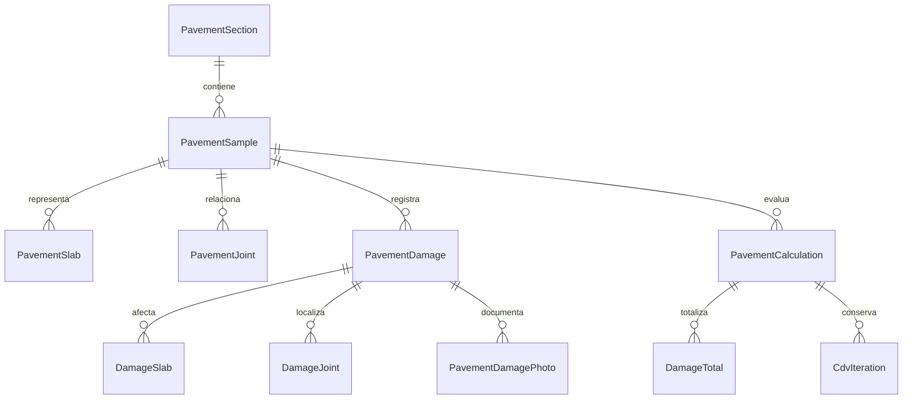

# GBO · Inspección de pavimentos

## Entrega 0: revisión, modelo, catálogos y boceto

**Estado: propuesta lista para revisión. Se espera confirmación antes de implementar la primera etapa.** No se modificó código Android, login, base de datos, configuración de compilación ni pantallas existentes. No se creó una aplicación nueva ni un APK. Esta propuesta sustituye las decisiones provisionales de la especificación anterior en lo que el nuevo pedido ya aclaró.

## 1. Cómo está organizado el proyecto y dónde encaja

El ZIP contiene un proyecto Android con un solo módulo Gradle `:app`, nombre `InventarioVial` y paquete `com.tuempresa.inventariovial`. No contiene historial `.git`, por lo que se trabaja sobre una copia del ZIP, sin afirmar una rama o commit de origen.

| Parte existente | Evidencia en el repositorio | Integración propuesta |
|---|---|---|
| Inicio y navegación | `MainActivity.kt`: `InventoryWorkspace`, `HomeScreen`, selección por estado Compose | Una tarjeta **Inspección de pavimentos** en Inicio y un destino `PavementWorkspace`, dentro de `AuthShell`. No inventar un código SIC para pavimentos. |
| Interfaz | Jetpack Compose y Material 3; `ui/theme/Theme.kt`, `Color.kt` | Reutilizar `InventarioVialTheme`, azul GBO `#163F7B`, rojo `#BD1235`, fondo `#F0F3F8`, tarjetas y campos existentes. |
| Acceso | `auth/AuthGraph.kt`, `AuthSessionManager.kt`, `AuthRepository.kt` | Obtener ID, nombre y usuario de `sessions.requireUser()` al crear/guardar. Inspeccionado por es de solo lectura. |
| Roles | `auth/UserEntities.kt`: ADMIN y OPERATOR | Conservar estos roles. No crear un tercer login ni nuevos roles en esta fase. |
| Almacenamiento | Room, `InventoryDatabase`, `inventario_vial.db`, versión 10 | Añadir tablas de pavimentos mediante migración aditiva 10→11. Probar conservación de inventario, SCAP y usuarios. |
| Módulo de referencia | `scap/{data,catalog,domain,calculator,ui,export}` | Crear separación análoga bajo `pavement/`; no reutilizar índices o daños SCAP. |
| Cabecera vial | `field/SurveyHeader.kt`, `SurveyPreferences`, `road/ContractualPrInput.kt` | Reutilizar selección de tramo, ruta, calzada y representación PR; no asumir que todo código PR es un kilómetro. |
| Fotos | `camera/PhotoUtils.kt`, `PhotoStampService.kt`, `RequiredWatermark.kt`, FileProvider | Reutilizar captura/orientación y política de sello. Adaptar almacenamiento a fotos de daños sin exigir coordenadas GPS ficticias. |
| Excel | `export/SicExcelWriter.kt`, exportadores SCAP | Reutilizar enfoque XLSX Open XML compatible con Android, sin librerías de escritorio. El escritor SIC no ofrece directamente el informe de pavimentos: necesita un exportador específico. |
| Exportación y sincronización | Drive, WorkManager, servidor y políticas existentes | Guardado local primero. Incorporar pavimentos con su contrato propio; no enviar fichas como SIC/SCAP ni declarar sincronización exitosa sin respuesta. |
| Pruebas | `src/test`, `src/androidTest`, esquemas Room 4–10 | Añadir pruebas acotadas de geometría, catálogo, migración, cálculo y exportación en las etapas correspondientes. |

Versiones declaradas en el ZIP: AGP 9.4.1, Kotlin/Compose plugin 2.2.10, Compose BOM 2026.02.01, Room 2.8.5, SDK mínimo 26 y compile/target 37. Son valores leídos del proyecto; no se han actualizado ni se ha validado su resolución/compilación en esta entrega documental.

### Navegación propuesta

Inicio existente → **Inspección de pavimentos** → lista de inspecciones → ficha de muestra → esquema/daños → cierre y resultado → reportes.

El nuevo destino debe incorporarse a `safeAtHome`: mientras haya una ficha abierta o guardado pendiente no se debe considerar que la persona está en Inicio. También se debe revisar la condición de cambio de usuario de `AuthRepository/AuthGraph`, que hoy se concentra en recorridos activos. Recuperar un borrador conserva el inspector original; editarlo no debe reasignar su autor.

### Carpetas previstas, después de aprobar

```text
app/src/main/java/com/tuempresa/inventariovial/pavement/
  data/         entidades Room, DAO, repositorio y migración
  model/        superficies, geometrías y resultados tipados
  catalog/      lector de catálogos JSON
  domain/       validaciones, exclusiones y conteos
  calculator/   densidades, curvas e iteraciones
  ui/           lista, ficha, Canvas del esquema y editor
  export/       PDF y XLSX
app/src/main/assets/pavement/
  catalogos/{asfalto,rigido,no_pavimentado}/catalogo_danos.json
  curvas/{asfalto,rigido,no_pavimentado}.json
```

En esta entrega los archivos se conservan como propuesta bajo `docs/pavimentos/etapa0`, sin incorporarlos todavía al código ejecutable ni duplicar fuentes de catálogo activas. El catálogo consolidado es la fuente de revisión; los tres catálogos por superficie son particiones generadas y verificadas del mismo contenido.

## 2. Referencias realmente disponibles

El ZIP **no contiene** `docs/Manual_PCI_URCI.pdf` ni `docs/Formato_para_programa_1.xlsx`. Contiene otras referencias de inventario y SCAP. Se recuperaron los dos adjuntos originales de esta conversación y se copiaron con esos nombres en `docs/` de la copia de trabajo. El manifiesto registra huellas SHA-256 para identificar la versión usada.

Excel verificado: Hoja1, boceto y campos; Hoja2, trece columnas sin registros. El manual tiene 286 páginas. Se revisaron las fichas de los 46 daños y las tablas de severidad; las curvas no se digitalizaron ni se estimaron visualmente.

## 3. Modelo de datos propuesto

Los nombres siguientes son identificadores internos nuevos del módulo, no códigos viales inventados. Se usarán UUID para relaciones y un consecutivo separado para la etiqueta visible.

### 3.1 Sección de pavimento (`PavementSection`)

| Campo | Tipo / origen | Uso |
|---|---|---|
| id | UUID interno | Identidad estable. |
| tramo, ruta | Texto; cabecera existente | Conservar códigos reales del proyecto. |
| superficie | ASFALTO / RIGIDO / NO_PAVIMENTADO | Define catálogo e índice. Adoquines se añadirá como otra familia en el futuro. |
| calzada | Texto nullable; campo existente | Reutilizar significado del proyecto. |
| areaSeccionM2 | Decimal nullable; Ec. 6, p. 56 | Necesaria para combinar muestras aleatorias/adicionales. No deducirla de las muestras inspeccionadas. |
| metodoMuestreo | CENSAL / ALEATORIO / ALEATORIO_CON_ADICIONALES / SIN_DEFINIR | Distinción necesaria para Ec. 4–6. |

No agregar Faja como sinónimo automático de Calzada. Queda pendiente definir su independencia. Una sección debe ser homogénea para el método; no promediar asfalto, rígido y no pavimentado en un único índice.

### 3.2 Muestra (`PavementSample`)

| Campo | Tipo | Regla / procedencia |
|---|---|---|
| id, sectionId | UUID / relación | Una sección tiene varias muestras. |
| consecutivo | Entero positivo | Muestra, asignación transaccional y única por sección. No reutilizar números borrados. |
| tipoMuestra | CENSAL / ALEATORIA / ADICIONAL / SIN_DEFINIR | Necesario para agregación por sección. |
| carril, anchoCarrilM | Texto / decimal nullable | Excel y pedido. No igualar ancho de carril al ancho total de muestra. |
| prInicialCodigo, prInicialDistanciaM | Texto / decimal | Reutilizar el componente PR existente. |
| prFinalCodigo, prFinalDistanciaM | Texto / decimal | Conservar código y distancia además de la representación visible. |
| abscisaInicialM, abscisaFinalM | Decimales nullable, derivados | Solo cuando el catálogo de referencia permite obtenerlas. |
| sentido | Creciente / decreciente existente | Controla orden de progresivas, no invierte el eje local del esquema. |
| anchoM, largoM | Decimales positivos | Metros; área derivada = ancho × largo. |
| filasLosas, columnasLosas, numeroLosas | Enteros nullable | Solo rígido; grilla regular: producto filas×columnas concuerda con total. |
| fechaInspeccion | Fecha local ISO | Fecha de la visita, separada de auditoría de guardado. |
| inspectorUserId, inspectorUsername, inspectorNombre | ID y copia del usuario de sesión | No editables a mano; nombre conservado para informes históricos. |
| estado | BORRADOR / CERRADA | Cerrar la muestra es distinto de disponer de un índice calculable. |
| creadaEn, actualizadaEn, cerradaEn | Fecha/hora | Trazabilidad. |
| revision | Entero interno | Impedir que un cálculo/exportación obsoleto se presente como actual. |
| pasoCuadriculaM | Decimal positivo | Preferencia de dibujo, inicial 1 m según pedido. No altera mediciones. |

Área 140–320 m² para asfalto/no pavimentado y 12–28 losas para rígido generan **advertencias, no bloqueo**. Una losa con longitud ≥8 m genera advertencia según el pedido y la referencia de pp. 39–40. Filas/columnas no bastan para una geometría irregular: conservar las dimensiones por losa y no inventar juntas físicas.

### 3.3 Losas y juntas (`PavementSlab`, `PavementJoint`)

- **Losa:** id, sampleId, número visible, fila, columna, límites X/Y locales y longitud física. Para una grilla regular los límites se generan a partir de ancho/largo y filas/columnas. La numeración se documentará como convención de interfaz, independiente de los códigos de daños.
- **Junta:** id, sampleId, losaAId, losaBId y ubicación común. Permite seleccionar las dos losas de una junta sin multiplicar ciegamente todo conteo por dos.
- Las subdivisiones imaginarias de losas largas son una representación técnica diferenciada, no una modificación silenciosa del número de losas físicas. Su tratamiento queda pendiente de validación del manual.

### 3.4 Registro de daño (`PavementDamage`)

| Campo | Tipo / contenido |
|---|---|
| id, sampleId | UUID y relación. |
| correlativo | Entero único por muestra; etiqueta `código-#correlativo`, independiente del ID. |
| superficie, codigoDano, nombreDano, versionCatalogo | Familia, código oficial, copia del nombre y versión usada. |
| severidad | B / M / A o null. |
| estadoSeveridad | DETERMINADA / NO_APLICA / PENDIENTE. NO_APLICA no es un nuevo nivel. |
| geometria | LINEAL / AREA / CIRCULO / LOSAS / GLOBAL. |
| x1M, y1M, x2M, y2M | Coordenadas locales nullable; no son GPS. |
| centroXM, centroYM, diametroM | Solo círculo; diámetro en metros. |
| anchoM, longitudM, areaM2 | Dimensiones medidas; valores calculados y sustituciones manuales diferenciados. |
| cantidadFisica, cantidadTecnica, unidad | Hueco físico = 1; cantidad técnica puede ser equivalente. Para losas se deriva del conteo aplicable. GLOBAL no recibe una cantidad ficticia. |
| anchoFisuraMm | Opcional según ficha, milímetros. |
| profundidadMaxMm, profundidadMediaMm | Cuando la ficha lo requiera, particularmente huecos/ahuellamiento. No confundirlas. |
| origenMedida, motivoAjuste | DIBUJO / MANUAL; conservar valor geométrico y valor aceptado si se cambia. |
| observacion | Texto. |
| fechaHora, inspectorUserId, inspectorNombre | Tomados de sesión al crear; la edición conserva autor y registra editor. |
| actualizadoEn, actualizadoPor, eliminadoEn | Auditoría y eliminación lógica, útil para sincronización posterior. |

`DamageSlab` relaciona daño con IDs de losas afectadas, sin duplicados. `DamageJoint` conserva las juntas seleccionadas cuando la regla de conteo las necesita. No basta guardar solo un entero para explicar un conteo de 21 o 33.

### 3.5 Fotos (`PavementDamagePhoto`)

id, damageId, ruta local relativa, ruta de copia comprimida, fecha/hora, inspectorUserId, orden y estado de sincronización. Reutilizar FileProvider y utilidades de cámara. Las fotos pertenecen al daño y sobreviven a su edición/movimiento. No almacenar imágenes como cadenas dentro de las filas de cálculo.

Compresión: realizar una copia destinada a informe/sincronización y preservar la evidencia original conforme a la política existente. Calidad y resolución son parámetros de ingeniería de la app, no valores del manual; se definirán con prueba de legibilidad en tablet. Si no hay GPS, el sello no debe inventar una ubicación ni bloquear una medición local válida.

### 3.6 Cálculo (`PavementCalculation`, `DamageTotal`, `CdvIteration`)

- **Calculation:** sampleId, revisión de entrada, versión del catálogo, versión/huella de curvas, perfil técnico, fecha, estado CALCULABLE / NO_CALCULABLE / DESACTUALIZADO, faltantes, HDV, m, máximo CDV, índice y calificación nullable.
- **DamageTotal:** código/severidad, cantidad/unidad, densidad nullable, VD nullable y referencia exacta de curva o valor global.
- **CdvIteration:** secuencia, lista de VD aplicada (incluye valor fraccionado si corresponde), total, q, CDV y curva utilizada. Conservar tanto VD originales como lista reducida a m.
- **SectionCalculation:** muestras/revisiones incluidas, método Ec. 4/5/6, áreas utilizadas, faltantes e índice nullable. No omitir muestras incalculables para producir un promedio aparentemente completo.

Editar, mover o eliminar un daño, cambiar severidad o dimensiones invalida los resultados previos. Una muestra cerrada puede mostrar «PCI no calculable: falta curva …» y exportarse con ese estado; no guardar cero ni 100 como sustituto.

### Relaciones



## 4. Contrato de captura y esquema

- Plano en metros, origen inferior izquierdo, X ancho/Y largo, escala uniforme en ambos ejes. Un metro debe ocupar la misma distancia visual horizontal y vertical. Zoom/desplazamiento solo cambian la vista.
- LINEAL: dos puntos; distancia euclidiana inicial editable. No interpretar el segmento como una grieta curva realmente medida.
- AREA: dos esquinas; ancho absoluto, largo absoluto y área producto. Conservar área ajustada cuando se mida una forma irregular.
- CIRCULO: centro en cualquier lugar, diámetro y profundidad máxima para sugerir severidad. Un registro representa un hueco físico; la cantidad equivalente se trata aparte.
- LOSAS: seleccionar celdas identificadas y, para reglas de junta, seleccionar adyacencia. Distintas severidades se conservan como observaciones separadas, aplicando después la regla técnica por losa sin doble conteo.
- GLOBAL: una evaluación activa por muestra para 26 o 84; no dibujar, no asignar centro o cantidad = 1.
- Mover un daño actualiza su geometría y conserva ID/correlativo/fotos. Para el borde entre muestras se propone confirmar «izquierda o adelante» de acuerdo con la p. 50; no deducirlo por el número de muestra sin conocer adyacencia y sentido.
- Modificar abre el mismo registro; Aceptar valida y guarda localmente. Eliminar confirma el registro y conserva evidencia de la operación. Cierre guarda el estado de la muestra y solicita el cálculo; falta de curvas no destruye la captura.
- Botones principales de al menos 56 dp como decisión de interfaz para tablet/guantes; pantalla horizontal con esquema izquierdo y panel derecho. Desplazamiento del panel independiente del gesto sobre el esquema.

## 5. Catálogos entregados

`catalogo_danos.json` contiene las 46 fichas. Las particiones en `catalogos/` contienen 20 de asfalto, 19 de rígido y 7 de no pavimentado. Cada ficha tiene código, familia, nombre, unidad, geometría, modo de densidad, descripciones de severidad, texto extraído de respaldo, páginas, reglas de medida/exclusión y pendientes.

Las descripciones de interfaz son síntesis del capítulo 5; no introducen nuevos umbrales. Las matrices de los cuadros 5-6, 5-8, 5-11, 5-12, 5-13 y 5-16 están transcritas con B/M/A y sus rótulos originales. Los párrafos fuente conservan posibles pies de figura: el futuro lector de catálogo mostrará las descripciones limpias, no esos pies como criterio técnico.

Excepciones confirmadas:

- 19 no tiene severidad baja (p. 125).
- 12, 31, 32, 33 y 37 no definen niveles (pp. 106, 167, 169, 171, 182).
- 26 y 84 son globales sin densidad. El manual da valores explícitos: **26 B/M/A = 2/4/8** (p. 254) y **84 B/M/A = 2/5/15** (p. 275). Están documentados como referencia, todavía sin activar en el motor.
- 21 en junta que afecta ambas losas se cuenta en ambas; 33 requiere adyacencia para su regla de bombeo (pp. 133, 171).
- 23 M/A excluye otros daños en esa losa; avisar y resolver antes del cálculo. No borrar fotografías o registros automáticamente.
- En rígido algunas reglas elevan o consolidan la severidad: por ejemplo, dos grietas medias de 28 en una losa se reportan como alta (p. 159).

## 6. Curvas y motor: decisiones que requieren confirmación

Los tres JSON de `curvas/` contienen identificadores por daño/severidad, `puntos: []`, constantes globales aún sin activar y correcciones vacías. No hay puntos de ejemplo ni valores interpolados simulados. Un punto futuro tendrá `densidad` y `vd`; una curva de corrección tendrá `q` y puntos `total`/`cdv`, junto con página, escala y estado de validación.

| Tema | Pedido | Evidencia y propuesta para confirmar |
|---|---|---|
| URCI | Umbral 2 y factor 9/98 para todos | Manual pp. 59–60: umbral 5, factor 9/95 y reducción a 5. Recomiendo el perfil del manual para URCI; no elegirlo silenciosamente. |
| Interpolación | Densidad logarítmica | Hay ejes lineales en concreto y algunos de URCI, p. ej. pp. 253–255 y 275. Guardar escala por curva, con interpolación logarítmica solo cuando corresponda. |
| Máximo de cantidad | Todo daño ≤ área de muestra | Comparar únicamente magnitudes compatibles: m² con m²; losas con total de losas; 81 ≤ largo; 82 ≤ 2×largo; 87 suma cada cordón (p. 237). No comparar metros ni unidades con m². |
| Huecos | Cantidad = 1 | Conservar ocurrencia física =1, más cantidad técnica equivalente para diámetro >0,75 m en asfalto o >0,90 m sin pavimento (pp. 108/233). |
| Severidades | B/M/A | Respetar excepciones sin niveles y daño 19 sin B. |
| Globales | 26/84 sin dibujo | Ambos sin densidad; documentar constantes explícitas, no fabricar una curva. |
| Rígido 34 | Conteo especial | P. 173 ofrece variantes ASTM y Shahin para múltiples punzonamientos; dejar elección pendiente. |
| Rangos de condición | Intervalos 100–85, 85–70, etc. | Los límites compartidos necesitan una convención aprobada; no inventar pertenencia de 85, 70, 55, 40, 25 o 10. |

El cálculo diseñado conserva totalización por daño/severidad, HDV, m, parte fraccionaria, lista reducida, todas las iteraciones y máximo CDV. No aplicará extrapolación fuera del dominio ni interpolación entre valores q no documentados. Tampoco evaluará log(0) ni supondrá un punto (0,0) ausente.

El perfil de sección conserva Ec. 4 (p. 55), Ec. 5 y Ec. 6 (p. 56). Para muestras adicionales es indispensable el área de la sección. El ajuste descrito en 4.4.3 para varios niveles de severidad no se incorporará como si ya hubiera sido solicitado: se marcará la variante exacta del motor y se validará con el ejemplo resuelto.

## 7. Offline, inspector y filtros

Todo registro, catálogo y foto se guarda localmente; la captura no depende de solicitudes de red. La app ya tiene login offline con caché de usuarios, pero **el inicio de sesión requiere configuración inicial y una caché vigente de hasta 72 horas** (`AuthRepository`). No prometer acceso offline indefinido ni alterar esa política de seguridad para este módulo.

Filtros de la lista: inspector, tramo/ruta, fecha y superficie. El inspector mostrado y exportado es quien realizó la inspección, no quien exporta. Se conservarán ADMIN/OPERATOR; el alcance de consulta entre inspectores debe seguir la política existente que se confirme al implementar filtros.

El vínculo al usuario se incorpora desde la primera etapa; la quinta agrega búsqueda/filtros e integración completa de permisos. No se difiere la atribución de inspecciones hasta el final.

Exportar es independiente de sincronizar. El repositorio contiene integraciones Drive/servidor, pero no un contrato de pavimentos: su destino/payload quedará pendiente, con estado local explícito. No marcar como sincronizado un archivo que solo se creó en la tablet.

## 8. Informes previstos

**PDF:** cabecera completa, esquema a escala con números/correlativos, daños y geometrías, fotos, medidas, totales, densidades, VD, iteraciones, índice/calificación o causa de no cálculo. Usar una función de dibujo compartida para pantalla e imagen del informe. Exportar un daño global como condición de la muestra; no dibujar un daño inexistente.

**XLSX por superficie:** primeras trece columnas exactamente como el pedido y Hoja2. X/Y serán inicio o centro para huecos. Para LOSAS/GLOBAL no inventar un punto de inicio; la representación en las columnas espaciales queda pendiente y la lista de losas se preserva en datos y PDF.

`Progresiva Inicial | Progresiva Final | Daño | Severidad | X | Y | Ancho | Longitud | Ancho de Fisura | Observación | Carril | Ancho Carril | Inspeccionado`

Hoja `Resumen`: muestra, cantidades, cálculos y sección, incluyendo estado y faltantes. Las columnas extra X2, Y2, Tramo, Muestra y Fecha quedan desactivadas hasta confirmación. Si no se aceptan, la trazabilidad se mantiene por hoja/muestra y por el resumen; no descartar las coordenadas de la base local.

## 9. Etapas posteriores y verificación

| Etapa | Trabajo | Cómo se probará |
|---|---|---|
| 1. Esquema y registro | Entrada en Inicio, modelo Room/migración, sesión, catálogos, ficha, geometrías, edición/movimiento/borrado, fotos y guardado local. | Abrir desde login, crear las tres superficies, tocar/editar cada geometría, reiniciar sin red, conservar fotos/autor; migrar base v10 sin perder inventario ni SCAP. |
| 2. Cálculo | Densidades, conteos/exclusiones, lector de curvas, m/iteraciones, sección y estados no calculables. | Ejemplo resuelto que aportará el usuario; revisar cifras de cada iteración. Mientras no llegue, solo pruebas de contrato y ausencia de curvas, sin afirmar validación numérica PCI/URCI. |
| 3. PDF | Informe paginado y esquema común con fotos/tablas. | Comparar pantalla/informe; casos con varias páginas, texto largo, fotos y cálculo faltante. |
| 4. Excel | Tres exportadores/perfiles, primeras 13 columnas, Resumen y columnas adicionales si se aprueban. | Abrir archivos, verificar nombres/orden/unidades/fila por daño, no truncar códigos y no mezclar superficies. |
| 5. Usuarios/filtros | Filtros, restricciones de acceso y conexión con flujo existente de usuarios/exportación. | Operador/admin, bloqueo/reautenticación, autor histórico correcto, filtros combinados y persistencia offline. |

Al terminar cada etapa se entregará: cambios, instrucciones reproducibles para probar y TODO aún pendientes. No se pasarán por alto fallos de compilación o pruebas alegando que el boceto funciona.

## 10. TODO de esta entrega

1. `// TODO: validar con manual`: confirmar URCI 5 y 9/95 frente a la fórmula común del pedido.
2. `// TODO: validar con manual`: aprobar escala por curva y digitalizar VD/correcciones con revisión; ninguna curva está lista.
3. `// TODO: validar con manual`: confirmar aplicación de constantes globales 26 y 84, documentadas en pp. 254 y 275.
4. `// TODO: validar con manual`: confirmar límites compatibles por unidad y conteo equivalente de huecos.
5. `// TODO: validar con manual`: decidir variante de conteo de 34 y cualquier conflicto de conteo/exclusiones en una misma losa.
6. `// TODO: validar con manual`: cerrar límites ambiguos de tablas de severidad y clasificación del índice; no rellenar huecos por aproximación.
7. `// TODO: validar con manual`: definir la relación Calzada/Faja y origen/sentido de asignación en frontera de muestras.
8. `// TODO: validar con manual`: decidir representación de losas largas, número físico frente a unidades teóricas y losas irregulares.
9. `// TODO: validar con manual`: confirmar X2/Y2/Tramo/Muestra/Fecha extra y representación espacial de registros LOSAS/GLOBAL en Excel.
10. Recibir el ejemplo resuelto solicitado para las pruebas del motor y confirmar la variante 4.4.3 si se requiere.
11. Definir destino/contrato de sincronización de pavimentos y alcance de consulta entre operadores. Mantener login y política actual de 72 horas.

## 11. Verificación realizada

Revisión de archivos de entrada/navegación, Gradle, tema, auth, Room, cabecera/PR, fotos, exportadores y organización SCAP. Catálogos comprobados por cantidad de códigos, ausencia de duplicados, geometrías/unidades, excepciones de severidad y correspondencia entre catálogo consolidado y particiones. Curvas comprobadas como vacías. Comparación de hashes de todos los archivos originales del ZIP contra la copia de trabajo para confirmar que no se modificaron fuentes de la app.

No se ejecutó Gradle ni se probó un APK: esta fase entrega diseño y datos de referencia. La prueba resuelta de PCI/URCI queda pendiente del ejemplo del usuario, tal como se pidió.
