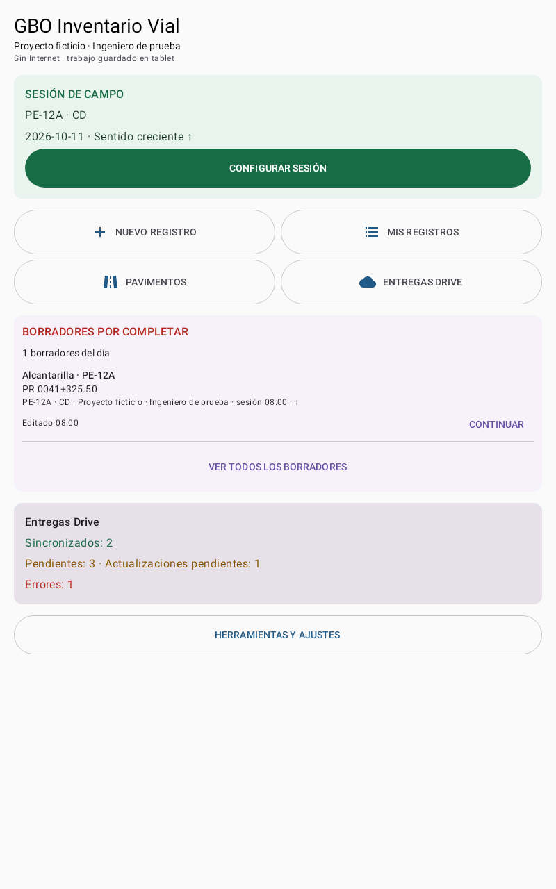
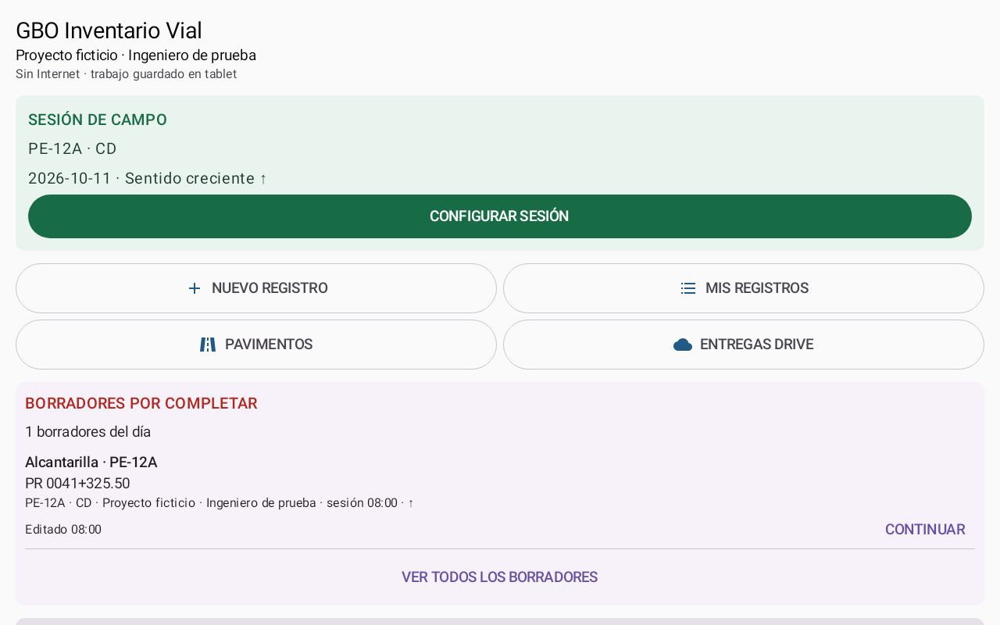
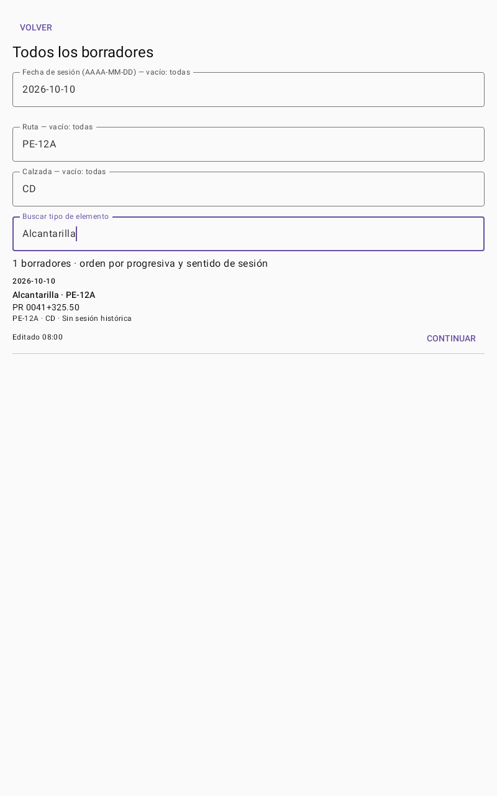

# Entrega Prompt 6 — dashboard, sesión y borradores

Checkpoint local en `codex/dashboard-sesion-6`, derivado de Prompt 5 `24df7d3562d823cc1382754b8a3950aed7f88e0e`. Worktree aislado `D:/Downloads/GBO_InventarioVial_INTEGRADO_FINAL_SOURCE/GBO_InventarioVial/prompt6`. Consultar el hash definitivo con `git rev-parse codex/dashboard-sesion-6`; se entrega también en la respuesta final. Sin push ni merge.

## Resultado

Inicio Material 3 con identidad de sesión, conexión resumida, tarjeta verde de iniciar/configurar, cuatro accesos reales y herramientas secundarias. Se conserva acceso a formularios SIC, historial, pavimentos, centro Drive, mapa/orden, Excel, KML, KMZ, archivos, SCAP/puentes, ajustes GNSS y administración autorizada.

Borradores del día con acento rojo, contador y scroll interno limitado a 360 dp; 50 registros probados sin ocupar toda la pantalla. Continuar utiliza el UUID original. El texto muestra tipo, ruta/calzada, PR/distancia, contexto y hora de modificación; no expone UUID. El listado completo permite fecha/ruta/calzada/tipo y conserva acceso a borradores antiguos.

Orden numérico por ruta/calzada/sesión/sentido/PR/distancia; respeta orden oficial del catálogo cuando existe, sin inventar equivalencias de longitud. Empates estables y registros sin posición al final. Observación, fotos, categorías y texto incompleto continúan en los stores existentes.

Fecha de sesión reutilizada de `FieldSession.startTime`. Configurar no cambia fecha, operador ni identidad. Borradores antiguos sin sesión conservan `sessionId=null` aun si hay una sesión activa nueva; para filtrar se usa creación original. Sin migración ni nueva base de borradores.

Resumen Drive separado en sincronizados, pendientes, errores y actualizaciones pendientes. Sincronizados exige estado/revisión confirmada, recibo y fecha de ACK existentes. Borradores incompletos se excluyen; georreferenciación externa no se interpreta como fallo de entrega. No se cambian backend ni workers.

## Verificación

**27 casos distintos aprobados: 17 de presentación/orden, 4 Robolectric de persistencia y 6 Compose.** La ejecución corregida aprobó 26/27; el único caso horizontal pendiente se repitió de manera individual y pasó. No se ejecutó la suite completa ni pruebas remotas.

`assembleDebug`: aprobado, APK local `app/build/outputs/apk/debug/app-debug.apk`.
SHA-256: `4d65f70cfbac4370c6cb3d671deee6f14003babe66be2508878ef7fdd58e030e`.
Firma Debug verificada: `d2e54cb086aa731ef046be300977d0b16c0d8f66fdcb08d0d9cfd2038bf0d872`, idéntica al checkpoint anterior. No APK Release ni instalación.

Room 18 / photo_history, applicationId `com.tuempresa.inventariovial`, versionCode 16, syncProtocol 3 / pathVersion 4 y PhotoCategoryVersion 1 conservados. Las propiedades Drive/usuarios/SDK se copiaron sin cambios y se excluyen del commit, junto a APK, caches y resultados crudos.

Errores iniciales conservados localmente: primera compilación falló por receiver de BoxWithConstraints; primera ejecución 27/4 fallos (contador sin ACK, PixelCopy en Robolectric y localizadores de filas lazy); segunda ejecución 27/1 fallo del regreso al encabezado horizontal. Correcciones y comprobaciones finales constan en [VALIDACION.json](VALIDACION.json). Logs y XML/binaries originales permanecen fuera del checkpoint en `focused-prompt6-*.log`, `initial-results/` y `refined-results/`.

[Matriz completa de requisitos, archivos y pruebas](MATRIZ.md). [Auditoría acotada y criterio histórico](AUDITORIA_INICIO.md).

## Capturas de prueba — datos ficticios, sin tablet física

Render real de los composables mediante Robolectric Native (`decorView.draw(Canvas)`); no son maquetas ni evidencia de una subida a Drive. PixelCopy no estuvo disponible en este entorno. Las tres capturas se inspeccionaron visualmente.

### Dashboard vertical — 800 × 1280

### Dashboard horizontal — 1280 × 800, fuente 130%

### Borradores históricos con filtros — 800 × 1280

## Validación física pendiente y límites

En dispositivo secundario de pruebas: iniciar/configurar una sesión, comprobar fecha estable, crear borradores con PR distintos/iguales/vacío y sentido decreciente; guardar un cambio de PR y revisar orden; continuar y verificar campos, observaciones y fotos. Comprobar filtros de históricos, scroll de muchos registros, cuatro accesos y herramientas; revisar horizontal/vertical, fuente ampliada y lector de pantalla.

SCAP y pavimentos conservan sus propios flujos/listados de borradores y acceso desde sus espacios; no se crea una cola paralela. Se mantiene la agrupación explícita de relaciones SIC existentes y el control de propietario previo. Los filtros de ruta/calzada son coincidencia exacta sin distinguir mayúsculas; fecha en formato AAAA-MM-DD. La lista principal cambia de día local en un máximo de 30 segundos con la app abierta.

No se verificaron archivos remotos de Drive en Prompt 6; la configuración local sigue siendo la del Prompt 5 y no se asume que su endpoint sea de pruebas. Cualquier futura comprobación remota requiere entorno aislado compatible V3/pathVersion 4/PhotoCategoryVersion 1, autorizado por el usuario. No se modificó Apps Script.

Trabajo previo de la copia operativa y worktrees 4/5 intacto, sin descartar ni atribuir sus modificaciones al Prompt 6. En prompt6 quedan sin commit plantillas SCAP/proguard/herramientas copiados para compilar, logs y resultados crudos; las propiedades privadas y APK permanecen ignoradas. **Detenerse aquí; no iniciar Prompt 7.**
