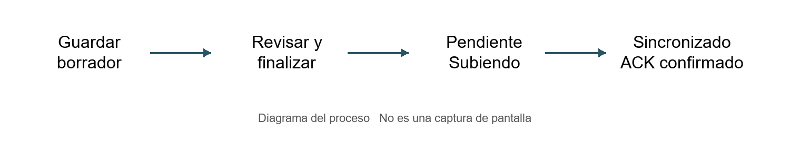
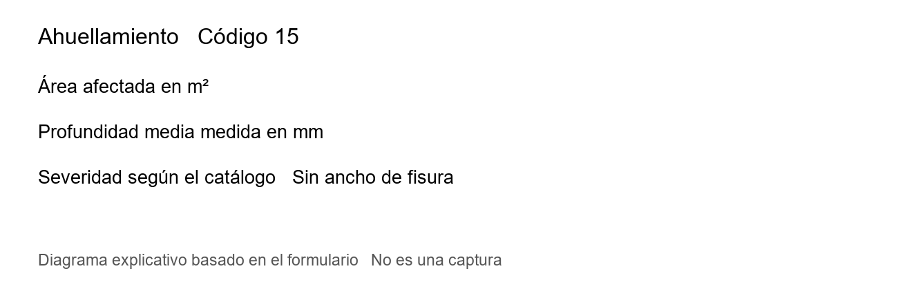
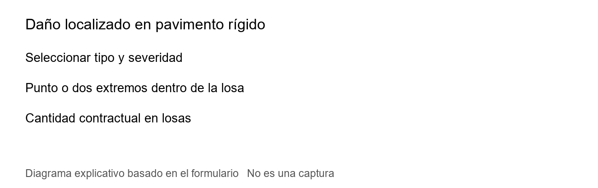
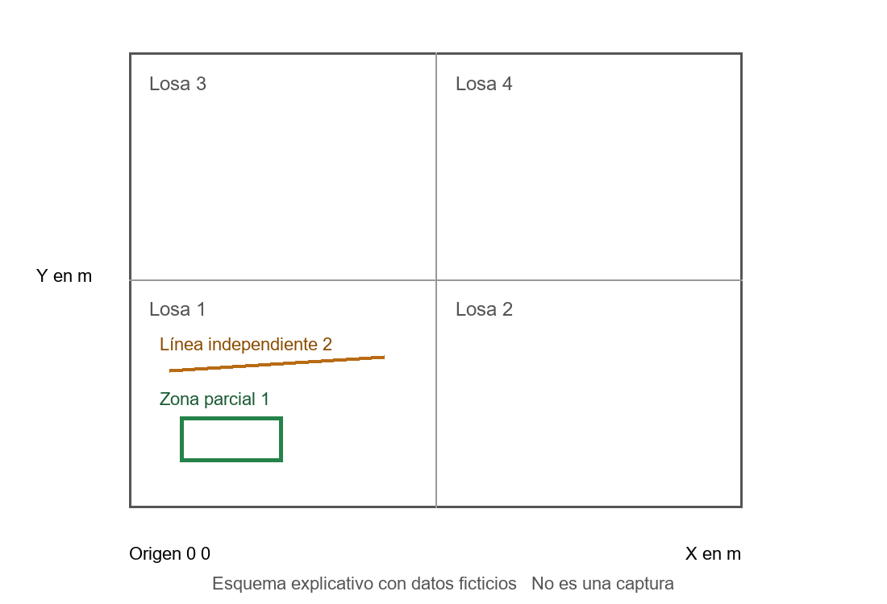

# Manual de usuario de GBO Inventario Vial

Edición de campo 10I | Candidata 1.4.3 | 13 de octubre de 2026

Este manual explica cómo registrar, revisar y entregar evidencias del inventario vial desde una tablet Android. Está dirigido al ingeniero que utiliza GBO por primera vez y al administrador que habilita a los usuarios. Los procedimientos corresponden a las funciones y textos del proyecto GBO Inventario Vial; los ejemplos y las imágenes de pruebas contienen exclusivamente datos ficticios.

La versión descrita es una candidata para revisión del propietario. La aceptación física de las correcciones y la actualización coordinada del servidor preceden a su distribución. Las capturas, cuando se incluyen, proceden de los componentes reales de la aplicación ejecutados en un entorno de pruebas aislado; no son fotografías de la tablet de campo. Los diagramas se identifican como explicaciones, no como capturas.

## 1 Objetivo y alcance del sistema

GBO reúne el registro de elementos SIC, la inspección SCAP de Puentes y la evaluación superficial de Pavimentos. Permite conservar fichas y evidencias en la tablet, revisar datos y preparar entregables. Cuando existe conectividad y los servicios están habilitados, entrega las revisiones a Drive y comprueba su confirmación.

El trabajo del operador no termina al tomar una foto. Debe comprobar que pertenece a la ficha o daño correcto, guardar los datos, revisar las advertencias, finalizar cuando corresponda y consultar la entrega. Un archivo visible en Drive y una ficha confirmada son comprobaciones diferentes; los videos tienen además su propia confirmación.

La aplicación admite borradores, por lo que conviene guardar el avance aunque falten datos. Las funciones de anulación remota y restauración de registros sincronizados no forman parte de esta entrega. El descarte de borradores locales no debe confundirse con eliminar una ficha entregada.

## 2 Usuarios y responsabilidades

El OPERADOR registra el trabajo de campo y utiliza los módulos habilitados. En Pavimentos, la edición de una muestra corresponde al inspector que la creó. Un usuario con rol ADMIN puede acceder a Administración y solicitar cambios del servicio central con una autorización online adicional.

El permiso para administrar tablets es independiente: la presencia de ese botón depende de la autorización asignada en el servicio. Tener rol ADMIN no autoriza automáticamente todas las operaciones futuras de administración ni la anulación de registros.

El propietario de GBO coordina instalaciones, actualizaciones y servicios. Debe entregar a cada tablet su configuración autorizada. El ingeniero no debe cambiar tokens, usar cuentas ajenas, eliminar usuarios para intentar liberar espacio ni modificar permisos de producción como solución a un error de conexión.

## 3 Preparación de la tablet

Antes de salir al campo, cargar la batería, comprobar espacio libre y verificar fecha y hora. Abrir GBO, iniciar sesión y comprobar que el proyecto y la ruta seleccionados corresponden al trabajo asignado. Sincronizar usuarios con Internet antes de una jornada prolongada sin conexión.

Conceder los permisos de cámara, ubicación y notificaciones que correspondan a las funciones utilizadas. Si se rechaza la cámara, puede ser posible incorporar una imagen existente; esa alternativa no reemplaza los datos de ubicación de la ficha. El receptor GNSS de la tablet proporciona una estimación de posición y precisión, no una certificación submétrica.

Preparar fotografías y videos de tamaño razonable. Mantener los originales en la aplicación y evitar mover, renombrar o limpiar sus carpetas internas. Si Android ofrece borrar datos o desinstalar para resolver un problema, detenerse y consultar al responsable: esas acciones pueden destruir pendientes y claves locales.

## 4 Instalación y actualización

Recibir la APK exclusivamente del responsable de GBO. Comprobar con él la versión y el tipo de instalación de la tablet. Una actualización compatible conserva applicationId y certificado de firma. La versión candidata de esta entrega es 1.4.3, versionCode 17; la última Release distribuida registrada por el propietario es 1.4.2, versionCode 16.

Una APK Release no puede actualizar una Debug firmada con otra clave. Si Android rechaza la instalación por incompatibilidad, no desinstalar ni borrar datos. Comunicar el mensaje exacto y esperar una actualización compatible o un procedimiento expresamente autorizado por el propietario.

Antes de actualizar, anotar la versión, la identidad de la tablet y el número de fichas o entregas pendientes. Después de una actualización autorizada, abrir GBO, iniciar sesión y comparar esos datos. Comprobar también que las fotografías y videos locales siguen disponibles. Esta entrega no instala ni distribuye automáticamente ninguna APK.

## 5 Inicio de sesión con usuario y PIN

En la pantalla de acceso, escribir el usuario asignado e introducir el PIN personalmente. Pulsar Iniciar sesión. No enviar el PIN por chat, correo, capturas ni informes de incidencias. El PIN admite entre seis y doce dígitos; el teclado del campo está preparado para números.

La primera configuración requiere Internet y el servicio de usuarios autorizado. En una tablet nueva, el responsable introduce la URL y el token de esa tablet en la pantalla existente y sincroniza los usuarios. Después, GBO puede verificar el PIN contra los datos cifrados conservados localmente para permitir el trabajo offline durante la vigencia de la caché, de hasta 72 horas desde la última sincronización correcta.

Cinco intentos fallidos producen un bloqueo temporal de cinco minutos. Si aparece Tu sesión venció, volver a introducir el PIN del usuario indicado; la ficha abierta se conserva. Una sesión puede bloquearse después de permanecer en segundo plano. No cambiar de operador para evitar esa comprobación.

Si aparece que se requiere actualizar usuarios, conectar la tablet y pulsar Sincronizar usuarios. Si se informa revocación o cambio de huella, consultar al administrador; reinstalar la aplicación no es un método de recuperación.

## 6 Identificación y autorización de tablet

GBO presenta una huella o código de dispositivo en la configuración de acceso y en las herramientas de administración. Ese código permite al responsable identificar la tablet y resolver su vinculación con el servicio. Compartir únicamente la huella cuando sea solicitada; no acompañarla del PIN ni del token privado.

Conservar el mismo usuario Android y la instalación compatible es importante para mantener identidad, claves y datos. Cambiar de firma o reinstalar no equivale a actualizar. Una tablet nueva necesita su propia provisión; no copiar las credenciales de otra.

El control adicional de activación del dispositivo y el login de usuario son mecanismos distintos. En esta entrega, el login normal sigue vigente. El operador no debe activar banderas técnicas ni sustituir el acceso por una lista local. Si aparece DISPOSITIVO NO ACTIVADO o un error de vinculación, guardar la evidencia del mensaje y contactar con GBO.

## 7 Inicio y navegación principal

Después de iniciar sesión, revisar el operador mostrado y la sesión de campo. El acceso principal permite llegar a Nuevo registro, Mis registros, Pavimentos y Entregas Drive, según el contexto de la pantalla. Los formularios ofrecen acciones de volver, guardar borrador, revisar, finalizar y consultar archivos.

Nuevo registro abre la selección del elemento que se va a inventariar. Mis registros permite localizar fichas existentes y continuar su revisión. Pavimentos abre las muestras y superficies. Entregas Drive permite revisar el estado de lo guardado y las revisiones confirmadas. Administración se muestra para los roles autorizados.

Antes de empezar otro elemento, confirmar que se está en el módulo correcto. Una ficha SIC, una inspección SCAP y una muestra de Pavimentos tienen identidades y reglas propias. No registrar una alcantarilla en Puentes ni añadir un daño de pavimento como si fuera un elemento vial independiente.

Figura 1. Diagrama explicativo del flujo real de guardado y entrega. No representa una captura de pantalla.

## 8 Sesión de campo y ubicación

Configurar la sesión con el proyecto, operador autenticado, ruta y calzada que correspondan. La ruta puede depender del catálogo del proyecto. Indicar el sentido del recorrido cuando el formulario lo solicite. No intercambiar creciente y decreciente para forzar un orden deseado.

Los códigos PR y las distancias localizan el elemento dentro de la vía. Conservar las unidades que muestra el formulario: metros, dimensiones o códigos del catálogo. La posición GNSS y la referencia contractual PR son datos relacionados, pero no equivalentes. Leer las advertencias de precisión y de distancia al eje antes de aceptar una posición.

Guardar un borrador si falta una medición o una equivalencia técnica. Un campo pendiente no debe completarse con un valor inventado para conseguir una entrega. La aplicación puede diferenciar una entrega técnica de una georreferenciación externa todavía pendiente. Consultar ambos estados cuando se requiera comprobar la calidad de la ubicación.

## 9 Crear un elemento SIC

1. En Inicio, entrar en Nuevo registro y elegir la familia o formato adecuado.
2. Revisar ruta y calzada; completar PR, distancia y ubicación inicial. Si el elemento tiene extensión, completar también su extremo final.
3. Elegir clase y tipo desde los catálogos. Completar las dimensiones y condiciones que correspondan a esa selección.
4. Incorporar evidencias en el apartado de fotografías. Comprobar visualmente que describen ese elemento.
5. Escribir las Observaciones al final del formulario, cuando exista ese campo.
6. Guardar borrador o pasar a revisión. Corregir los mensajes de campos faltantes antes de finalizar.
7. Tras finalizar, consultar el registro y su entrega. Con Internet disponible, esperar la revisión confirmada correspondiente.

Los formatos realmente presentes incluyen SIC de Puentes, Alcantarillas, drenajes, badenes y otras estructuras, señalización, derecho de vía, fajas, anchos, puntos críticos y accidentes, además de fichas complementarias habilitadas. Elegir el formato que corresponde a la observación, sin sustituirlo por uno parecido.

## 10 Campos y validaciones SIC

Los campos cambian según el tipo de elemento. Un código de catálogo no se escribe como una descripción libre si el control pide seleccionar una opción. La fecha debe ser válida en el formato indicado. Los PR admiten códigos numéricos de hasta cuatro dígitos en los formularios correspondientes; las distancias tienen límites de entrada mostrados por la aplicación.

En anchos de fajas, el ancho total no debe ser inferior al útil. Si la ubicación, dimensiones o datos obligatorios están incompletos, se puede conservar un borrador, pero eso no garantiza que el Excel esté listo para exportar. Las advertencias de equivalencia contractual no se resuelven inventando códigos.

Las opciones no aplicables o heredadas deben revisarse en su contexto. En SIC-18A, la cabecera procede de la alcantarilla principal; no crear otra alcantarilla para completar la ficha complementaria. En señales, revisar si el tipo exige código identificable y cómo se registra una señal que no puede identificarse.

## 11 Fotografías de elementos SIC

En el apartado de fotografías, usar Tomar foto o Incorporar fotos. Si se ofrece la selección de cámara, elegir una cámara detectada por Android o Cámara de Android. Capturar una imagen nítida, confirmar la toma y comprobar que aparece en la ficha antes de continuar.

Al incorporar imágenes, seleccionar archivos del elemento actual. Las categorías organizan la evidencia; no cambian por sí mismas la identidad de la fotografía. Cuando corresponda, asignar la categoría correcta antes de finalizar. La vista previa permite consultar el contenido y detectar una fotografía equivocada.

La aplicación conserva originales y adapta la evidencia para la entrega según el protocolo aprobado. Cambiar a mano la extensión de un archivo no convierte sus bytes en JPEG. Ante un rechazo NOT_JPEG, conservar la evidencia y seguir el procedimiento de incidencia; no desactivar la validación del servidor.

No publicar capturas de campo con datos personales o fichas de otros ingenieros para pedir ayuda. Si se necesita una imagen de diagnóstico, el responsable debe autorizarla y anonimizar los datos ajenos.

## 12 Editar fichas sin cambiar su identidad

Abrir Mis registros o el listado del módulo, localizar el elemento y entrar en su detalle. Verificar ruta, tipo y UUID antes de editar. Utilizar la acción de edición existente; no crear una segunda ficha para corregir la primera.

Modificar únicamente los datos comprobados. Guardar y revisar la nueva revisión. Si el registro ya estaba sincronizado, la edición debe terminar con una nueva entrega confirmada; el estado de una revisión anterior no confirma automáticamente la modificación actual.

La numeración y la identidad se conservan conforme a las reglas de la aplicación. No renombrar carpetas de Drive para conseguir otro número ni mover evidencias entre elementos. La anulación remota de una ficha entregada sigue pospuesta. El descarte local de un borrador conserva un propósito distinto y debe utilizarse solo sobre el registro correcto.

## 13 Registrar Puentes SCAP

Entrar en Puentes y crear o abrir la inspección correspondiente. Revisar la identificación del puente y el tipo de plantilla disponible. El proyecto contiene formularios contractuales LOSA y MODULAR, además del flujo SCAP existente; las secciones se adaptan al catálogo seleccionado.

Completar progresivamente identificación, características, elementos estructurales y observaciones técnicas. Revisar la existencia o aplicabilidad de cada elemento. Si se marca una sección como no aplicable, confirmar lo que advierte el formulario; la conservación de información previa no significa que esa sección siga siendo evaluada como presente.

Usar los avisos y el resumen para volver a los campos pendientes. Guardar durante el trabajo. Finalizar solo después de revisar la ficha y la evidencia. La entrega de la ficha padre es necesaria antes de confirmar los videos asociados. No repetir una inspección completa para intentar resolver únicamente un envío multimedia pendiente.

## 14 Fotografías y videos de Puentes

Los apartados multimedia corresponden a las categorías reales de la ficha. Las plantillas incluyen, entre otras, accesos, superficie de rodadura, aguas arriba, aguas abajo, elementos de losa, vigas, veredas, barandas, cauce y señal informativa. No elegir una categoría distinta para conseguir un nombre de archivo más corto.

FOTO abre la acción de fotografía; VIDEO permite Grabar video o Importar videos en Puentes SCAP. Los videos admitidos son MP4, WebM y 3GP, hasta 32 MiB por archivo. Una grabación o importación correcta debe quedar reproducible en la tablet. Si es demasiado grande, preparar una copia reducida o un segmento adecuado fuera de la evidencia ya registrada, conservando el original.

El video puede esperar a que se finalice y sincronice su ficha padre. Cada tarjeta muestra su estado, progreso cuando corresponde y acciones de reproducción o reintento. Una evidencia confirmada no debe volver a importarse para reintentar: usar su propia acción Reintentar, para conservar su identidad y evitar otra evidencia independiente.

Los nombres legibles de videos requieren que el servidor anuncie la capacidad específica de nombres V2. Video V1 por sí solo no garantiza esa capacidad. Cuando está disponible, nombres como 001_PUE1_ARR.mp4 identifican el consecutivo, puente y apartado. Las evidencias históricas conservan sus nombres y rutas técnicos; no se renombran automáticamente.

## 15 Abrir una muestra de Pavimentos

Entrar en Pavimentos y seleccionar Asfáltico, Rígido o No pavimentado. Revisar los filtros de ruta, tramo e inspector para no confundir una muestra anterior con una nueva. La tarjeta muestra el estado y permite continuar o consultar según permisos y situación de la muestra.

En la cabecera, completar ruta, tramo, número de muestra, calzada, carril, PR inicial y final, ancho y longitud. Para Rígido, definir además filas, columnas y dimensiones de losas. La identificación de muestra no debe duplicar otra de la misma ruta, tramo, calzada y superficie.

Confirmar las dimensiones antes de registrar daños. La aplicación impide cambiar la grilla o las dimensiones cuando ya existen daños, para no desplazar los registros respecto de su referencia física. No eliminar daños reales con el único fin de eludir esa protección.

## 16 Pavimento Flexible y ahuellamiento

Seleccionar el daño que realmente se observa en Asfáltico. La aplicación distingue daños lineales, áreas afectadas y huecos, además de las particularidades del catálogo. Marcar inicio y final para línea o zona; en huecos, marcar el centro y completar la medición solicitada.

Para Ahuellamiento, registrar el área afectada en metros cuadrados y la severidad correspondiente a la profundidad media medida. La profundidad media se obtiene a partir de varias mediciones a lo largo de la huella, siguiendo el manual técnico del proyecto. El formulario corregido muestra Profundidad media del ahuellamiento y no solicita Ancho de fisura.

La severidad no se obtiene de un dibujo aproximado. Revisar el texto técnico de la severidad y las reglas de medición disponibles en el propio formulario. No transferir el ancho de una grieta a la profundidad de una huella ni borrar valores históricos ocultos: la versión conserva esos datos sin usarlos como una medición aplicable nueva.

Figura 2. Diagrama de los datos del ahuellamiento. No es una captura de pantalla.

## 17 Pavimento Rígido y numeración de losas

La grilla se define mediante filas y columnas. El origen del esquema está en la esquina inferior izquierda: X aumenta hacia la derecha y Y hacia arriba, en metros de la muestra. La losa 1 está en la fila inferior; la numeración continúa por columnas de izquierda a derecha y luego por filas.

Comparar esa orientación con el sentido del levantamiento antes de dibujar. Una marca en una losa equivocada puede afectar el conteo aunque el símbolo tenga buena apariencia. Si se necesita describir un daño en otra posición, comprobar tanto las coordenadas como el campo Losas afectadas.

El esquema es una ayuda de localización. Los daños rígidos siguen utilizando su unidad contractual, losas, cuando así lo define el catálogo. Una zona de un metro cuadrado dentro de una losa no se transforma automáticamente en una fracción de losa para PCI. Las reglas de consolidación de severidades y exclusiones permanecen vigentes.

## 18 Registrar una falla localizada

1. Elegir el tipo de daño y su severidad cuando corresponda.
2. Mantener activa Localizar daño dentro de una losa.
3. Para una ubicación puntual, tocar una vez su posición. Para una línea o zona parcial, marcar dos puntos dentro de la misma losa.
4. Revisar en el editor las coordenadas X1 e Y1 y, para línea o zona, X2 e Y2. Se expresan respecto de la muestra completa, no desde la esquina de la losa.
5. Confirmar la losa asociada, la severidad y las observaciones. Guardar con Aceptar.
6. Comprobar que el dibujo ocupa la posición observada. Para otro daño independiente, crear otro registro; puede tener otro tipo o severidad en la misma losa.

El tipo de marca depende del daño. Las grietas lineales se representan con extremos; las ubicaciones puntuales tienen un símbolo local; las zonas se delimitan por sus dos esquinas. El rectángulo o símbolo es un croquis, no una medición automática del área contractual.

Para una junta que compromete dos losas, revisar la regla técnica del daño y las losas indicadas en el editor. No asignar ambas losas a cualquier daño por proximidad. El modo sin localización conserva el símbolo por losa y permite seleccionar varias; representa una asociación, no una delimitación parcial medida. Los registros históricos sin coordenadas mantienen ese significado.

Figura 3. Diagrama del procedimiento de localización. No es una captura de pantalla.

## 19 Revisar editar y consultar el esquema

Seleccionar el daño de la tabla para relacionar su número con el dibujo. Revisar código, severidad, cantidad y posición. Modificar abre el registro existente y conserva su identidad. Para cambiar una ubicación rígida localizada, editar las coordenadas y las losas indicadas; si la geometría sale de esas losas, la aplicación debe pedir su corrección.

En los daños cuya pantalla ofrece Mover en esquema, arrastrar y comprobar la posición al soltar. Esa operación conserva las cantidades medidas. La edición de coordenadas de un daño rígido no cambia por sí sola su cantidad contractual de losas.

Dos daños independientes pueden coexistir dentro de una misma losa. La evaluación aplica las reglas del catálogo: por ejemplo, el conteo consolidado puede utilizar la severidad más alta para un mismo tipo y losa. No sumar manualmente todos los símbolos visibles como si cada uno fuera otra losa. Consultar las advertencias de exclusiones antes de cerrar la muestra.

Figura 4. Diagrama explicativo de dos daños independientes en una losa. No es una captura ni una medición contractual.

## 20 Fotografías asociadas a un daño

En la tabla, utilizar el icono de cámara o Ver fotos del daño correcto. En el panel correspondiente aparecen Tomar foto e Incorporar fotos. Una fotografía de un daño debe quedar asociada a su UUID concreto, incluso si existen dos registros del mismo tipo.

Después de la toma o importación, consultar la imagen. Verificar orientación, nitidez y correspondencia con la falla. El apartado de Pavimentos no ofrece captura de video; si aparece una acción de video, anotar la versión de la aplicación y comunicar la incidencia sin finalizar sobre un daño equivocado.

Para reemplazar, abrir Reemplazar y elegir Tomar reemplazo o Importar reemplazo. La sustitución se confirma cuando la nueva imagen se guarda en ese daño. Para retirar, utilizar la acción del panel y confirmar el mensaje. El original y el historial se conservan; retirar del panel no borra automáticamente una evidencia remota.

Una muestra cerrada permite consultar sus fotografías. Para corregir contenido, el inspector creador debe usar Reabrir para corregir cuando esté disponible. Conservar el daño y su evidencia al girar la tablet, salir de la pantalla y volver a abrirla; comprobar el panel antes de finalizar otra revisión.

## 21 Revisar y finalizar muestras

Pulsar Revisar y finalizar. Comprobar cabecera, número de daños, severidades, cantidades y advertencias. Los datos medidos deben estar completos; una muestra sin dimensiones o con identificación incorrecta no está lista para cerrarse.

La aplicación calcula o deja pendiente el índice de acuerdo con los datos y curvas disponibles. Un resultado pendiente no es cero ni equivale a una evaluación favorable. Leer el motivo antes de utilizar el valor en un informe. Esta versión no cambia arbitrariamente las fórmulas PCI o URCI ni deduce cantidades rígidas a partir del croquis.

Al confirmar el cierre, conservar la muestra y revisar la entrega. Si se requiere una corrección posterior, el inspector creador puede reabrirla, efectuar la modificación, revisar y finalizar nuevamente. La confirmación de la revisión anterior no confirma esa nueva corrección.

## 22 Trabajo sin Internet

GBO conserva datos y evidencias localmente para permitir el levantamiento sin conexión, dentro de las condiciones de acceso ya sincronizadas. Guardar los borradores con regularidad y verificar que las imágenes y videos se pueden consultar desde la aplicación.

Una ficha finalizada puede quedar pendiente de entrega hasta que se recupere Internet. No duplicarla para intentar enviarla otra vez. Conectar la tablet, abrir GBO y consultar Entregas Drive; si corresponde, usar el reintento de la misma ficha o evidencia.

No limpiar caché y datos como una sola operación, cambiar de usuario Android ni eliminar carpetas internas mientras existan pendientes. Conservar batería suficiente para terminar de guardar. Al volver a una zona con conexión, sincronizar usuarios y revisar las entregas antes de cerrar la jornada.

## 23 Sincronización Drive y confirmaciones

Una revisión local describe la versión guardada en la tablet. La revisión confirmada identifica la que el servidor aceptó. Al editar, ambas pueden diferir hasta que termine la entrega. Revisar la identidad de la ficha y las revisiones en Detalles de entrega Drive cuando se investiga un problema.

El estado Sincronizado exige la confirmación correspondiente; no debe deducirse únicamente porque la conexión volvió o desapareció una barra. Las fotos se entregan con la ficha según el protocolo habilitado. Los videos SCAP esperan su padre y realizan una subida reanudable y una confirmación propia.

Al interrumpirse la conexión, conservar la misma evidencia y reintentar. El mecanismo utiliza sus identificadores para continuar sin crear otra por cada intento. Volver a importar el mismo archivo, en cambio, puede representar otra evidencia solicitada por el operador; no es la acción indicada para recuperar una subida.

## 24 Significado de los estados

| Estado o mensaje | Interpretación y acción |
| --- | --- |
| Borrador o pendiente de completar | Está conservado localmente, pero debe revisarse o finalizarse antes de entregar. |
| Pendiente | Espera conectividad, validación, disponibilidad del servicio o ejecución del envío. Consultar el detalle. |
| Pendiente de finalizar y sincronizar ficha | El video conserva su original; necesita primero la confirmación de la ficha padre. |
| Subiendo | Existe una transferencia en curso. Mantener conectividad y consultar el resultado final. |
| Reintentando o error de conexión | El intento no terminó; usar el mismo registro y conservar originales. |
| Sincronizado | El servidor confirmó la revisión o evidencia indicada. Comprobar que corresponde a la revisión local actual. |
| Error o rechazo del servidor | Revisar el mensaje y los identificadores. No borrar la entrega bloqueada para ocultarlo. |
| Pendiente del backend | La capacidad requerida no está habilitada o disponible. El responsable coordina el servidor; no se resuelve con datos ficticios. |

Al comunicar una incidencia, copiar UUID o identidad, revisión local, revisión confirmada, estado, mensaje, versión y hora aproximada. No copiar PIN, tokens, URLs privadas de carga ni datos de fichas ajenas.

## 25 Historial y entregables

En Mis registros o en el listado del módulo, localizar el registro por ruta, tipo e identificación. Entrar en su detalle para consultar contenido y estado. El historial ayuda a distinguir una edición de otro elemento. Las fotografías retiradas o reemplazadas pueden conservarse en su historial; no reutilizar sus archivos para otra ficha por fuera de la aplicación.

En SIC, la acción Exportar prepara los Excel de los formatos disponibles y los archivos de apoyo que correspondan. En SCAP se generan las fichas Excel de la plantilla seleccionada. Pavimentos dispone de Excel, PDF del esquema y cálculo, y las opciones de preparación o compartición que muestra su panel. Las funciones KML o KMZ corresponden a su módulo de exportación y a los datos disponibles; un mapa no sustituye la entrega contractual de la ficha.

Elegir Guardar, Abrir o Compartir cuando la pantalla lo ofrezca. Android puede pedir una aplicación compatible o una ubicación de destino. Conservar la relación entre el archivo y su registro. No asumir que abrir un Excel local equivale a que Drive aceptó la revisión.

## 26 Observaciones en Excel SIC

Escribir las observaciones del elemento al final de su formulario. En esta candidata, los formatos principales con ese campo agregan OBSERVACIONES como última columna, sin desplazar las anteriores. El texto se escribe en la fila de su propio elemento. Los formatos complementarios sin un campo independiente no reciben una columna inventada.

Si se escribe PINTADO OK 57 E2, la celda contiene únicamente PINTADO OK 57 E2. No se agregan títulos, fechas ni prefijos. Una observación vacía produce una celda vacía. Las cadenas que comiencen por un signo de fórmula se guardan como texto, no como fórmulas ejecutables.

Al editar una observación, guardar y finalizar la revisión correspondiente, preparar de nuevo el archivo y comprobar la misma fila. Cada elemento conserva su texto propio. El informe HTML de observaciones puede existir como apoyo, pero no reemplaza la columna del Excel.

La consolidación de esta columna en Drive requiere la actualización coordinada del backend preparada en 10I. Hasta que el responsable confirme esa actualización y su prueba, no considerar verificada su integración remota. Esa instalación corresponde a GBO, no al operador de campo.

## 27 Administración de usuarios

Esta sección corresponde a usuarios ADMIN autorizados. Desde Inicio, entrar en Administración. Revisar la fecha de actualización de usuarios. Los cambios requieren conexión; la lista local puede consultarse offline.

1. Introducir personalmente el PIN de administrador y pulsar Autorizar cambios online. Esa autorización dura cinco minutos.
2. Pulsar Nuevo usuario. Escribir un nombre de usuario de entre 3 y 64 caracteres permitidos: letras sin espacios, números, punto, guion o guion bajo. Evitar nombres ya registrados.
3. Completar el nombre de la persona, de hasta 120 caracteres. Elegir únicamente el rol autorizado por el propietario.
4. Introducir y repetir un PIN de entre 6 y 12 dígitos. No usar el PIN de otro usuario.
5. Pulsar Guardar en el servicio central y esperar su respuesta. Sincronizar usuarios si el cambio quedó guardado pero falta actualizar la lista local.

Si vence la autorización, renovar el permiso con el PIN y repetir la operación según el mensaje, sin crear cuentas duplicadas. Si no aparece Nuevo usuario, comprobar el rol, desplazarse por la pantalla y revisar que no exista otra ventana abierta. En esta versión, los grupos de acciones se adaptan al ancho disponible.

No se ha demostrado un límite real de altas en el servidor de Usuarios. No eliminar usuarios para intentar resolverlo. Para investigar un rechazo, el responsable necesita rol efectivo, versión, paso exacto, cantidad aproximada de usuarios, conectividad y mensaje completo, sin PIN ni datos personales innecesarios.

## 28 Errores frecuentes

| Situación | Acción recomendada |
| --- | --- |
| Usuario o PIN incorrecto | Revisar el usuario asignado e introducir el PIN personalmente. Esperar si hay bloqueo temporal. |
| Tu sesión venció | Volver a iniciar sesión con el usuario indicado; conservar la ficha abierta. |
| Se requiere actualizar usuarios | Recuperar Internet y sincronizar; solicitar ayuda si la tablet está revocada o desvinculada. |
| No se abre la cámara | Revisar permiso y selección de cámara. Probar Cámara de Android o incorporar una imagen autorizada. |
| El daño ocupa otra losa | Comprobar origen, grilla, coordenadas y números de losas; modificar el mismo daño. |
| No se guarda la geometría | Corregir puntos fuera de muestra, zona de tamaño cero o geometría que sale de las losas indicadas. |
| No aparece Observaciones en Drive | Comprobar la nueva revisión y la actualización del backend con el responsable. Revisar primero el Excel local de la candidata. |
| NOT_JPEG | Conservar original y entrega; comunicar identidad y revisiones. No renombrar extensiones ni eliminar la evidencia. |
| Video pendiente del backend | Comprobar la capacidad del servidor con GBO y que la ficha padre esté confirmada. No importarlo de nuevo para reintentar. |
| No se puede crear usuario | Confirmar ADMIN, Internet, autorización online vigente, campos válidos y ausencia de duplicado. Conservar el error exacto. |
| Android rechaza la actualización | Detenerse y consultar firma y versión con GBO; no desinstalar ni borrar datos. |

## 29 Rutina de cierre y protección de información

Antes de abandonar una ubicación, revisar identificación, mediciones y evidencias. Guardar el avance. Al terminar la jornada, conectar la tablet y comprobar las revisiones pendientes, los videos y los errores. Conservar una relación de incidencias que permita al responsable recuperar el caso por UUID.

Mantener la tablet bajo custodia, proteger el acceso Android y utilizar la cuenta propia. No compartir APK, credenciales o carpetas internas fuera del grupo autorizado. Los registros de prueba deben estar identificados como ficticios y autorizados, sin modificar fichas de los ingenieros.

No renumerar carpetas ni editar consolidaciones de Drive para ocultar una inconsistencia. No borrar bases de datos, claves, originales o envíos bloqueados. Una corrección se realiza sobre el registro identificado y su nueva revisión, con comprobación posterior de la entrega.

Para solicitar soporte, indicar módulo, versión, identidad o UUID, estado y revisiones, mensaje exacto y pasos realizados. Describir lo observado sin sustituirlo por una causa supuesta. El responsable decidirá si se requiere una prueba autorizada, una actualización o una corrección del servicio.

## 30 Referencias de esta edición

El manual se elaboró a partir de las pantallas y contratos de GBO: navegación principal, login y administración, formularios SIC, SCAP LOSA y MODULAR, editor de Pavimentos, catálogo de daños, galerías, renderizador de exportación y estados de sincronización. Las correcciones y dependencias de esta candidata se detallan en ENTREGA_10I.md y MATRIZ_OBSERVACIONES_10I.md.

Las capturas y ejemplos de esta edición no acreditan una prueba física de instalación ni un despliegue del backend. El propietario debe revisar el manual y los resultados antes de distribuir la candidata. La anulación remota y la restauración de registros sincronizados permanecen pospuestas.
